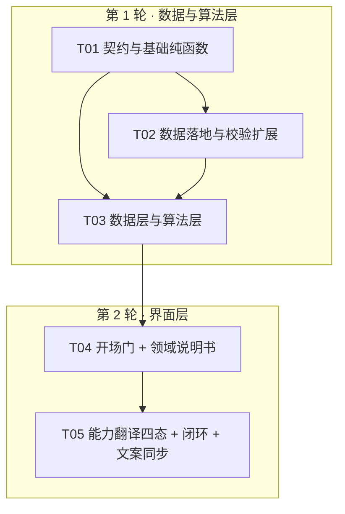

# 职途 · 增量架构设计 v0.1（ARCH-increment-v0.1）

> 类型：**增量架构设计 + 任务分解**
> 来源：《职途-产品设计说明-v0.1》全量落地，增量 PRD `tasks/PRD-increment-v0.1.md`
> 编写：架构师 高见远（Gao）· 2026-09-26
> 面向：实现工程师（两轮）/ 主理人
> 语言：中文
> 配套：`tasks/ARCH-class-diagram.mermaid`、`tasks/ARCH-sequence-diagram.mermaid`

---

## 0. 结论速览（给主理人）

1. **不引入任何新依赖**：运行时零 LLM 的硬约束下，所有新增能力都用「纯函数 + 现有 SQLite + 现有 React/MUI-free 组件」实现。`package.json` 只新增测试脚本注册，不加依赖。
2. **新增 4 个数据文件、4 个纯函数模块、2 个组件**；改造 `lib/db.ts` / `lib/matcher.ts` / `lib/types.ts` / `app/plan/page.tsx` / 3 个组件 / 2 个脚本 / 2 个文档。
3. **`orientation` 独立前置门**：不占用 `step 0–4`，作为 `profile.orientation` 持久化（随 `user_profile.profile` JSON 走，**不需要改 `user_profile` 表结构**）。老草稿缺该字段 → 视为 `skipped=true`，直接进原流程。
4. **⚠️ 两处必须在实现前知晓的事实**（详见 §9）：
   - **`components/Orientation.tsx` 已存在**，但它是「方向匹配概览」（嵌在岗位库页），**不是** PRD 说的开场定位。新开场门必须另起名（本设计用 `OpeningGate.tsx`），**禁止覆盖**。
   - **`scripts/demo/verify-workspace.mjs` 当前已经是坏的**：它引用的 `最近一件你认真做过的事` / `拆开这段经历` / `确认会` 三个可定位元素在当前 UI 中**完全不存在**（已全仓 grep 确认）。它不是因为「新开场门」才挂，而是早已与现有 UI 脱节。必须**重新基线化**，不能只加一步「跳过开场」。
5. **最大风险**：数据落地（133 岗位 × `workTags` + 109 技能 × 时效字段 + 13 方向说明书）必须与扩展后的 `validate-data.mjs` **同一次提交**，且同时满足「每 tag ≥3 岗 / 每 tag 覆盖率 ≤60% / 每岗 ≥1 条 core 内容 tag / `confidence` 与 `sample_size` 自洽 / 109 技能 100% 可解析交付物」5 组约束。这是本轮唯一可能「改完跑不通」的地方。

---

# Part A：系统设计

## 1. 实现方案 + 框架选型

### 1.1 核心技术难点

| 难点 | 说明 | 方案 |
| --- | --- | --- |
| **运行时零 LLM** | 设计说明 4.1 第二层「LLM 兜底」、5.3 第②层「LLM 抽事实」本轮**不实现** | 第二层改写为 `lib/skill-fallback.mjs` 纯规则近似；第②层改写为正则/字符串检测（`lib/evaluate-deliverable.ts`）。**不引入任何网络请求、embedding、OCR** |
| **不破坏已验证流程** | `step 0–4` 取值域、`matchJob`/`buildPath`/`profileText` 行为、14 项单测 + 3 项 API 冒烟 | `orientation` 做成**独立前置门**（不进 `step`）；`actionTemplate` 只**扩展返回字段**、不改 `buildPath` 排序逻辑；`initKB` 新字段全部可选、缺省安全 |
| **向后兼容迁移** | 老库 `career.db` 升级后 `user_profile`/`user_plans`/`user_jds` 数据不丢 | 沿用 `lib/db.ts` 现有 `PRAGMA table_info` + `ALTER TABLE ADD COLUMN` + **单列 try/catch**；新增 5 张表全走 `CREATE TABLE IF NOT EXISTS` |
| **`orientation` 不入分** | Q10：现有公式「覆盖率 75% + 加分项 15% + 方向契合 10%」与「每分可解释」原样保住 | `orientation` 结果**只用于过滤与排序**，绝不传入 `matchJob`。`orientation.ts` 与 `matcher.ts` 之间**零依赖** |
| **方向级候选** | 主理人纠正：PRD 4.9 的 `candidates.jobId` 错了，应为方向级 | 候选主键改为 `trackId`，附 1–2 个代表岗位作示例；`excludedTrackIds`/`partialTrackIds` 与 P0-5 验收自洽（见 §3.2） |
| **数据落地体量大** | 133 岗位 × tags、109 技能 × 时效、13 方向说明书 | 按 track 归类 + 逐岗依据 `summary`/`core`/`threshold` 标注；`confidence` 由 `sample_size` **机械推导**，保证自洽（见 §8） |

### 1.2 框架选型

| 层 | 选型 | 理由 |
| --- | --- | --- |
| 前端 | **Next.js App Router + React 19 + TypeScript**（沿用） | 现有栈；本轮只增组件与状态，不动路由框架 |
| 样式 | **Tailwind v4**（沿用） | 现有 `app/globals.css` / `app/trial.css`；视觉规范 P0-8 用现有 utility 类即可满足，不引入 UI 库 |
| 存储 | **`node:sqlite`（Node 22 内置）**（沿用） | 零依赖；4 张新表 + 扩展列足够；SQLite 单机完全覆盖 6.6 的规模估算 |
| 算法 | **纯函数 TS / MJS**（沿用 `lib/*.ts` + `lib/*.mjs` 混合） | 与 `skill-matching.mjs` 一致：`.mjs` 供 Node 测试与浏览器共用；`lib/freshness.ts` 等与 `matcher.ts` 同构 |
| 测试 | **`node:test` + `node:assert/strict`**（沿用） | `npm test` 用 `--experimental-strip-types` 直接跑 `.ts`；新增 4 个测试文件同机制 |
| 可视化 | 原生 SVG / Canvas（沿用） | `MarketBoard.tsx` / `CareerChoices.tsx` 已用；无新依赖 |

### 1.3 架构模式

- **分层**：`data/*.json`（唯一真源）→ `lib/db.ts`（迁移 + 种子化 + 读写）→ `/api/knowledge`（整库下发）→ `lib/matcher.ts` / `lib/orientation.ts`（浏览器本地纯函数计算）→ `components/*`（渲染）。
- **纯函数边界**：`freshness` / `orientation` / `skill-fallback` / `evaluate-deliverable` **四个模块全部无副作用**，可独立单测，符合现有 `matcher.ts` 的「每个数字都能追溯」原则。
- **单一数据源**：`data/jobs.json` 的 `workTags` 是**唯一真源**，同步镜像到 `job_work_tags` 表（PRD 4.8 要求）；`data/exclusions.json` 只放 tag 定义，**不放一对一手写映射**（修正设计说明 9.1 的错误）。

---

## 2. 文件列表及相对路径

### 2.1 新增（NEW）

| 路径 | 说明 | 轮次 |
| --- | --- | --- |
| `data/exclusions.json` | 开场排除 10 内容 tag + 7 条件 tag 定义（PRD 4.1） | R1 |
| `data/starter-skills.json` | 第 3 步技能基础 9 项 → `skillId` 映射（PRD 4.3） | R1 |
| `data/deliverable-types.json` | 10 种交付物类型 × `requiredElements`（PRD 4.6） | R1 |
| `data/action-templates.json` | 13 分类默认行动模板（PRD 4.6） | R1 |
| `lib/freshness.ts` | 时效纯函数 `getFreshness` / `formatVerifiedAt`（P0-19） | R1 |
| `lib/orientation.ts` | 开场排除纯函数 + `TRACK_EXCLUDE_RATIO`（P0-2/5，Q5） | R1 |
| `lib/skill-fallback.mjs` | 第二层规则近似兜底纯函数（P0-11） | R1 |
| `lib/evaluate-deliverable.ts` | 验收评判规则层纯函数（P0-15/17） | R1 |
| `components/OpeningGate.tsx` | 开场：第一屏 + 三步 + 输出页（P0-1~8） | R2 |
| `components/DomainBrief.tsx` | 领域入门说明书视图（P0-9） | R2 |
| `tests/freshness.test.mjs` | 时效 4 个边界单测 | R1 |
| `tests/orientation.test.mjs` | 排除算法 + 等级边界单测 | R1 |
| `tests/skill-fallback.test.mjs` | 别名/子串/fuzzy + 误命中防护单测 | R1 |
| `tests/evaluate-deliverable.test.mjs` | 规则层等级映射单测 | R1 |
| `tasks/ARCH-class-diagram.mermaid` | 本设计类图 | — |
| `tasks/ARCH-sequence-diagram.mermaid` | 本设计时序图 | — |

### 2.2 修改（MODIFY）

| 路径 | 改动 | 轮次 |
| --- | --- | --- |
| `data/jobs.json` | `jobs[].workTags`、`jobs[]` 5 时效字段、`tracks[]` 说明书字段、`_meta.version` `3.1→3.2` | R1 |
| `data/skills.json` | `skills[].action`（迁移现有 7 条）、5 时效字段、`_meta.version` `3.1→3.2` | R1 |
| `lib/types.ts` | `OrientationResult`/`OrientationCandidate`/`ActionEvaluation`/`ExperienceParts` 扩展/`Profile` 新字段（PRD 4.9） | R1 |
| `lib/db.ts` | 迁移（5 新表 + 扩展列）、`seedIfEmpty`（新字段 + `job_work_tags` + `knowledge_meta`）、`getKnowledgeBase`（新字段 + 4 个数据文件）、`insertRawJdObservation` | R1 |
| `lib/matcher.ts` | `actionTemplate` 三级解析（导出 + 传 `category`）、`PathItem` 增 `deliverableType`/`requiredElements`、`initKB` 接收扩展 KB | R1 |
| `app/api/jds/parse/route.ts` | P1-1：解析后**一次 INSERT** 写入 `raw_jd_observations`（可关闭，无聚合查询） | R1 |
| `scripts/data/validate-data.mjs` | 扩展 5 组校验（P1-3、P0-26、P0-14） | R1 |
| `package.json` | `test` 脚本注册 4 个新测试文件 | R1 |
| `app/plan/page.tsx` | 接入 `OpeningGate` / `DomainBrief`；`PathView` 提交评判闭环；`navigate(2)` 重算 | R2 |
| `components/SkillTranslation.tsx` | 候选卡四态（确认/否认/修改/暂不确定）+ 第二层兜底接入 | R2 |
| `components/PathView.tsx` | 提交产出物 + 规则评判 + 等级升级 + 「X% → Y%」；**文案同步改写** | R2 |
| `components/ExperienceInput.tsx` | 新字段（`title`/`partTags`/`hasDeliverable`/`deliverableNote`/`experienceType`/`timeline`），**合并文本不变** | R2 |
| `components/GapView.tsx` | 时效标注接入（`formatVerifiedAt`），可选 | R2 |
| `README.md` | 「完成行动不自动提升技能或证据等级」→ 新口径（P0-18） | R2 |
| `docs/COMPETITION-ITERATION.md` | 同上，两处同步 | R2 |
| `scripts/demo/verify-workspace.mjs` | **重新基线化**到当前 UI + 新增「跳过开场」可定位控件 | R2 |

### 2.3 删除（DELETE）

无。**特别声明：不得删除或覆盖 `components/Orientation.tsx`**（它服务于岗位库页的「方向匹配概览」，与本轮新开场门是两件事）。

---

## 3. 数据结构与接口

### 3.1 完整 DDL（`lib/db.ts` · `migrate()`）

沿用现有写法：`CREATE TABLE IF NOT EXISTS` + `PRAGMA table_info(<table>)` 检查 + `ALTER TABLE ... ADD COLUMN` + **单列 try/catch**。为降低 30+ 列重复代码的风险，新增内部工具（语义与现有写法完全一致）：

```ts
/** 与现有 PRAGMA + ALTER + try/catch 语义一致；仅抽掉重复样板 */
function ensureColumns(d: DatabaseSync, table: string, specs: [string, string][]) {
  const cols = new Set((d.prepare(`PRAGMA table_info(${table})`).all() as { name: string }[]).map((c) => c.name));
  for (const [name, ddl] of specs) {
    if (cols.has(name)) continue;
    try { d.exec(`ALTER TABLE ${table} ADD COLUMN ${ddl}`); }
    catch { /* 单列失败不影响其它列与既有数据 */ }
  }
}
```

```sql
-- ============ 设计说明 7.1：全局版本表 ============
CREATE TABLE IF NOT EXISTS knowledge_meta (
  id            INTEGER PRIMARY KEY,
  version       TEXT NOT NULL,        -- '3.2'
  published_at  TEXT NOT NULL,
  notes         TEXT
);

-- ============ 设计说明 7.2 + PRD 新增：jobs 扩展 ============
-- 逐列 ensureColumns(d, "jobs", [...])，每列独立 try/catch
ALTER TABLE jobs ADD COLUMN source_date TEXT;      -- '2026-03'
ALTER TABLE jobs ADD COLUMN updated_at  TEXT;      -- 系统自动写
ALTER TABLE jobs ADD COLUMN verified_at TEXT;      -- 最后人工复核（ISO 日期）
ALTER TABLE jobs ADD COLUMN sample_size INTEGER;   -- 基于几份 JD
ALTER TABLE jobs ADD COLUMN confidence  TEXT;      -- high | medium | low
ALTER TABLE jobs ADD COLUMN work_tags   TEXT;      -- JSON [{tag,tier,note,reviewStatus}]（真源，镜像到 job_work_tags）

-- ============ skills 扩展 ============
ALTER TABLE skills ADD COLUMN source_date TEXT;
ALTER TABLE skills ADD COLUMN updated_at  TEXT;
ALTER TABLE skills ADD COLUMN verified_at TEXT;
ALTER TABLE skills ADD COLUMN sample_size INTEGER;
ALTER TABLE skills ADD COLUMN confidence  TEXT;
ALTER TABLE skills ADD COLUMN action      TEXT;    -- JSON {deliverableType,deliverable,acceptance}

-- ============ tracks 扩展（领域说明书，PRD 4.4）============
ALTER TABLE tracks ADD COLUMN one_liner       TEXT;
ALTER TABLE tracks ADD COLUMN sub_directions  TEXT;  -- JSON string[]
ALTER TABLE tracks ADD COLUMN glossary        TEXT;  -- JSON [{term,plain}]
ALTER TABLE tracks ADD COLUMN entry_cycle     TEXT;
ALTER TABLE tracks ADD COLUMN hard_thresholds TEXT;  -- JSON string[]
ALTER TABLE tracks ADD COLUMN data_note       TEXT;
ALTER TABLE tracks ADD COLUMN verified_at     TEXT;
ALTER TABLE tracks ADD COLUMN sample_size     INTEGER;
ALTER TABLE tracks ADD COLUMN confidence      TEXT;

-- ============ 选项 → 岗位映射（PRD 4.1/4.2，多对多 + 两档）============
CREATE TABLE IF NOT EXISTS job_work_tags (
  job_id        TEXT NOT NULL,
  tag_id        TEXT NOT NULL,
  tier          TEXT NOT NULL,                       -- 'core' | 'incidental'；仅 core 触发排除
  note          TEXT,                                -- 判定依据，可追溯
  review_status TEXT NOT NULL DEFAULT 'assumed',     -- ★ PRD 4.2 要求：confirmed | assumed
  PRIMARY KEY (job_id, tag_id, tier)
);
CREATE INDEX IF NOT EXISTS idx_job_work_tags_tag ON job_work_tags(tag_id, tier);

-- ============ 设计说明 7.3：用户 JD 观察表（只增不改）============
CREATE TABLE IF NOT EXISTS raw_jd_observations (
  id            INTEGER PRIMARY KEY AUTOINCREMENT,
  job_id        TEXT,
  raw_text      TEXT NOT NULL,
  text_hash     TEXT,                                -- 去重
  parsed_skills TEXT,                                -- JSON 数组
  source        TEXT,                                -- 'user_paste' | 'manual'
  created_at    TEXT NOT NULL
);
CREATE INDEX IF NOT EXISTS idx_obs_job ON raw_jd_observations(job_id, created_at);

-- ============ 设计说明 7.4：变更建议表（不自动改库）============
CREATE TABLE IF NOT EXISTS change_suggestions (
  id             INTEGER PRIMARY KEY AUTOINCREMENT,
  job_id         TEXT NOT NULL,
  skill_id       TEXT NOT NULL,
  suggestion     TEXT NOT NULL,                      -- add | remove | upgrade_weight
  current_value  TEXT,
  proposed_value TEXT,
  evidence_count INTEGER,
  status         TEXT DEFAULT 'pending',
  created_at     TEXT NOT NULL,
  resolved_at    TEXT
);

-- ============ P2 前置：聚合任务断点 ============
CREATE TABLE IF NOT EXISTS aggregation_state (
  task              TEXT PRIMARY KEY,                -- 'raw_jd_aggregate'
  last_processed_id INTEGER NOT NULL DEFAULT 0,
  updated_at        TEXT NOT NULL
);
```

> **相对 PRD 4.8 的一处增补**：`job_work_tags` 增加 `review_status` 列。PRD 4.2 明确要求条件 tag 要有 `reviewStatus: 'confirmed' | 'assumed'` 并在 UI 标注「（此项为人工初判，待校准）」，但 4.8 的 DDL 漏了该列。本设计补上，`jobs[].workTags[].reviewStatus` 同步落 JSON 与表。

**`confidence` 定义（写死，双端校验）**

| 值 | 条件 |
| --- | --- |
| `high` | `sample_size >= 15` 且经人工确认 |
| `medium` | `5 <= sample_size < 15` |
| `low` | `sample_size < 5` |

### 3.2 前端类型（`lib/types.ts`）

```ts
export type CandidateLevel = "高" | "中高" | "中" | "低";
export type FreshnessLevel = "fresh" | "referenceable" | "needs_review" | "outdated";

/** 岗位工作标签（真源在 jobs.json.workTags，镜像到 job_work_tags） */
export interface WorkTag {
  tag: string;
  tier: "core" | "incidental";       // 仅 core 触发排除
  note: string;                       // 判定依据来源：summary | core | threshold | growth | JD
  reviewStatus: "confirmed" | "assumed";
}

/** ★ 主理人纠正：候选以 trackId 为主键（方向级），不再用 jobId */
export interface OrientationCandidate {
  trackId: string;
  trackName: string;
  level: CandidateLevel;
  reasons: string[];                  // 「依据」栏
  pending: string[];                  // 「待确认」栏
  sampleJobIds: string[];             // 1–2 个代表岗位，仅作示例说明
}

export interface OrientationResult {
  contentExcluded: string[];          // contentOptions.id
  contextExcluded: string[];          // contextOptions.id
  excludedJobIds: string[];
  excludedTrackIds: string[];
  partialTrackIds: string[];          // 部分相关，未整体排除
  candidates: OrientationCandidate[]; // 方向级 Top 3
  excludedReasons: { trackId: string; trackName: string; reason: string; assumed: boolean }[];
  contextDowngraded: boolean;         // Q4：条件排除压到 <3 → 降级为排序权重
  skipped: boolean;
  completedAt: number;
}

export interface ActionEvaluation {
  actionId: string;                   // `${jobId}:${skillId}:${kind}`
  deliverableType: string;
  requiredElements: string[];
  confirmedElements: string[];
  ruleHits: string[];                 // 规则检测命中的要素（「我看了你的什么」）
  artifactTitle?: string;
  artifactLocation?: string;          // 简历面板导出前置；非空才可能到等级 4
  quantitativeResult?: string;        // 简历面板导出前置
  suggestedLevel: number;             // 规则层建议 1–4
  finalLevel: number;                 // 用户可推翻后的最终值
  overridden: boolean;
  reviewRequested?: boolean;          // Q8：零 LLM 下的「申请复核」
  reviewReason?: string;
  note?: string;
  evaluatedAt: number;                // 年度能力表前置（时间戳）
}

export interface ExperienceParts {
  title?: string;                     // 新增：项目/经历名称
  what: string;
  part: string;
  partTags?: string[];                // 新增：负责部分多选
  tools: string;
  problem: string;
  result: string;
  hasDeliverable?: "yes" | "no" | "unsure";  // 新增
  deliverableNote?: string;           // 新增
}

export interface Profile {
  // …现有字段保持不变…
  experienceParts?: ExperienceParts;  // 由内联结构改为引用
  experienceType?: "course" | "competition" | "club" | "internship" | "parttime" | "personal" | "none";
  experienceTimeline?: string;
  orientation?: OrientationResult;                     // 新增
  pendingCandidates?: Record<string, "uncertain" | "modified">;  // 候选卡后两态
  actionEvaluations?: Record<string, ActionEvaluation>;          // 新增
  evidenceText?: Record<string, string>;                // 8.1 前置
  evidenceResult?: Record<string, string>;              // 8.1 前置
}
```

> `emptyProfile` 不新增必填字段（全部可选），保证老画像 `{...emptyProfile, ...old}` 读取不报错、不丢数据。
> `Persisted` / `plan-storage.ts` **无需改动**：`orientation` 随 `profile` JSON 一起持久化，`user_profile` 表结构不变。

### 3.3 模块导出签名

```ts
/* ---------- lib/freshness.ts（纯函数，零副作用） ---------- */
export type Freshness = "fresh" | "referenceable" | "needs_review" | "outdated";
export const FRESHNESS_LABEL: Record<Freshness, string>;   // 中文档位名，供 UI 直接用
export function getFreshness(verifiedAt: string | null | undefined, now?: Date): Freshness;
//  <90d fresh / <180d referenceable / <365d needs_review / ≥365d outdated；null/非法 → 'outdated'
export function formatVerifiedAt(verifiedAt: string | null | undefined, now?: Date): string;
//  <1d「今天复核」/ <30d「N 天前复核」/ <365d「N 个月前复核」/ ≥365d「YYYY-MM-DD 复核」
//  null/非法 → 「复核时间未知」

/* ---------- lib/orientation.ts（纯函数） ---------- */
export const TRACK_EXCLUDE_RATIO = 0.6;   // ★ 待校准（Q5）
export interface OrientationInput { contentOptionIds: string[]; contextOptionIds: string[]; knownSkillIds: string[]; }
export interface OrientationKB {
  jobs: { id: string; title: string; track: string; workTags?: WorkTag[] }[];
  tracks: { id: string; name: string }[];
  contentOptions: { id: string; tag: string; label: string; reason: string }[];
  contextOptions: { id: string; tag: string; label: string; reason: string }[];
  starterSkills: { id: string; label: string; skillIds: string[] }[];
}
export function computeOrientation(input: OrientationInput, kb: OrientationKB): OrientationResult;
/** 等级纯函数：未被排除 tag 匹配数 + 已勾选基础命中技能权重 → 高/中高/中/低（禁止百分比） */
export function estimateCandidateLevel(unexcludedTagMatch: number, knownSkillWeightHits: number): CandidateLevel;
/** 校验：确保映射出的 skillId 全在库内（白名单，matcher 侧一次） */
export function filterKnownSkillIds(ids: string[], knownIds: Set<string>): string[];

/* ---------- lib/skill-fallback.mjs（纯函数，无网络） ---------- */
export type FallbackSource = "exact-alias" | "alias-group" | "substring" | "fuzzy";
export interface FallbackHit { id: string; source: FallbackSource; confidence: "high" | "medium" | "low"; matchedText: string; }
export const ALIAS_GROUPS: { canonical: string; terms: string[] }[];  // 如 取数/拉数/查数 → sql
export function findSkillFallback(text: string, skills: { id: string; name: string; aliases: string[] }[]): FallbackHit[];
//  依次：别名组 → 子串包含 → 拉丁词条编辑距离 ≤2；只提候选，绝不自动勾选；java≠javascript

/* ---------- lib/evaluate-deliverable.ts（纯函数） ---------- */
export interface DeliverableInput {
  type: string;
  artifactTitle?: string;
  artifactLocation?: string;
  artifactNote?: string;
  userElementChecks: Record<string, "yes" | "no" | "unsure">;
}
export interface EvaluationResult {
  suggestedLevel: number;              // 1–4（等级 5 不由本函数给出）
  confirmedElements: string[];
  missingElements: string[];
  ruleHits: string[];
}
export function requiredElementsFor(type: string, types: Record<string, { requiredElements: string[] }>): string[];
export function evaluateDeliverable(input: DeliverableInput, types: Record<string, { requiredElements: string[] }>): EvaluationResult;

/* ---------- lib/matcher.ts（改造，行为不变） ---------- */
export interface ActionTemplate { deliverable: string; acceptance: string; deliverableType: string; requiredElements: string[]; }
export function actionTemplate(id: string, name: string, category?: string): ActionTemplate;
//  ① skills[].action（技能级） → ② actionTemplates.byCategory[category]（{skill} 替换） → ③ deliverable-types 兜底 → ④ 通用兜底
export interface PathItem {
  skillId: string; name: string; weight: number; estHours: number; priority: number;
  cumulativeWeeks: number; resources: ResourceRef[]; kind: "learn" | "evidence";
  deliverable: string; acceptance: string;
  deliverableType: string;             // 新增
  requiredElements: string[];          // 新增（供评判）
}
export function initKB(data: {
  skills: any[]; jobs: any[]; tracks: any[];
  meta: { version: string; note: string; salaryNote: string };
  // 以下全部可选，缺省为空 → 保持 matcher.test.mjs 兼容
  exclusions?: { contentOptions: any[]; contextOptions: any[] };
  starterSkills?: { items: any[] };
  deliverableTypes?: { types: Record<string, { label: string; requiredElements: string[] }> };
  actionTemplates?: { byCategory: Record<string, { deliverableType: string; deliverable: string; acceptance: string }> };
  knowledgeMeta?: { version: string; publishedAt: string; notes?: string };
}): void;
```

### 3.4 数据文件结构（新增 4 个）

- **`data/exclusions.json`**：`_meta` + `contentOptions[10]` + `contextOptions[7]`，字段 `{id, tag, label, reason}`。**权威数据在岗位侧**（`jobs[].workTags`），本文件只放 tag 定义与文案。
- **`data/starter-skills.json`**：`_meta` + `items[9]`，`{id, label, skillIds[]}`。Q3：`media-edit` 借用 `visual-design` + `motion-design`（不新增技能，保持 109）。
- **`data/deliverable-types.json`**：`_meta` + `types{10}`，`{label, requiredElements[]}`。
- **`data/action-templates.json`**：`_meta` + `byCategory{13}`，键**必须等于 `skills.json` 的 13 个 category 原值**：`基础/数据/AI/前端/后端/产品/运营/软技能/设计/安全/游戏/移动端/基础架构`（已核对现有数据）。

---

## 4. 程序调用流程

> 完整时序见 `tasks/ARCH-sequence-diagram.mermaid`；类图见 `tasks/ARCH-class-diagram.mermaid`。

### 4.1 主链路（开场定位 → 领域说明书 → 经历 → 能力翻译 → 匹配 → 证据审计 → 行动 → 提交评判 → 升级重算）

```
① 开场定位（独立前置门，不占 step）
   第一屏（无输入框）─主按钮─▶ 第1步 内容排除(≤4) ─▶ 第2步 条件排除(≤3) ─▶ 第3步 基础盘点(选填)
        │                                                                    │
        ├─ 次入口「已经想清楚了？直接选方向」/ 每步「跳过定位」──────────────▶ orientation.skipped = true
        ▼
   computeOrientation(input, kb)  ← lib/orientation.ts（纯函数）
        · excludedJobIds = jobs.filter(workTags 含 core 命中 tag)
        · 方向级聚合 ratio → excluded / partial / keep（TRACK_EXCLUDE_RATIO=0.6）
        · Q4 兜底：仅条件排除后候选 <3 → contextDowngraded=true（降级为排序权重）
        · 输出页：已排除 N 个方向 + 逐条理由 + 候选 Top3（等级，非百分比）+ 免责声明
        ▼  selectedTrackId
② 领域入门说明书（view="brief"，可跳过）
   tracks[trackId] → oneLiner / subDirections / glossary(可复制) / entryCycle / hardThresholds / dataNote
   freshness: formatVerifiedAt(track.verifiedAt) + sampleSize + confidence
   出口：「换一个方向看看」/「直接开始记录经历」→ navigate(0)
        ▼
③ 经历采集（step 0 · ExperienceInput）—— 新字段，experiences 合并文本不变
        ▼
④ 能力翻译（step 1 · SkillTranslation）
   第一层 detectSkillsDetailed（保持）
        │ 未命中
   第二层 findSkillFallback（lib/skill-fallback.mjs，纯规则）
        ▼
   候选卡：命中原文高亮 + 理由 + 置信度(含 source) ─▶ 四态 确认/否认/修改/暂不确定
        确认 → knownSkillIds += id（默认证据 1）
        否认 → dismissed
        修改 → 改指向 skillId 或降级为 customSkills
        暂不确定 → pendingCandidates[id]="uncertain"
        ▼
   第三层 词条归一（手动补充时）：精确 id→name→alias→别名组→近似
        命中 → 库内 skillId（参与匹配分）；未命中 → customSkills（只记录）
        ★ 白名单校验：matcher 侧 filterKnownSkillIds + API 侧（/api/jds 已校验）各一次
        ▼
⑤ 岗位匹配（step 2 · CareerChoices）—— 无结构性改动；orientation 只做过滤/排序，不入分
        ▼
⑥ 证据审计（step 3 · GapView）—— 无结构性改动；新增 formatVerifiedAt 时效标注
        ▼
⑦ 最小补强行动（step 4 · PathView）
   buildPath → actionTemplate 三级解析 → {deliverable, acceptance, deliverableType, requiredElements}
        ▼ 用户勾选「已完成」
⑧ 提交产出物 → 评判 → 升级（step 4 内展开态）
   requiredElementsFor(type) → 用户逐条自评(有/无/不确定) + artifactNote
   evaluateDeliverable(...) → { suggestedLevel, confirmedElements, missingElements, ruleHits }
   UI 展示「我看了你的什么」（ruleHits 原文片段 / 「未检测到（规则不会替你做判断）」）
   用户可逐条推翻 → finalLevel；可「申请复核」→ reviewRequested=true（Q8，进个人待办）
   finalLevel > 当前 evidenceLevels[skillId] → 写入 evidenceLevels + actionEvaluations
        ▼
   navigate(2) 重算 matches → PathView 展示「技能覆盖 X% → Y%」「项目证据覆盖 X% → Y%」
```

### 4.2 兼容分支（不破坏现有流程）

| 场景 | 判定 | 行为 |
| --- | --- | --- |
| 老草稿缺 `orientation` | `profile.orientation == null && started == true` | 视为 `skipped=true`，**直接进 step 0**（不显示开场门） |
| 新用户 | `!started && !profile.orientation` | 显示开场门 |
| 点「跳过定位」/ 次入口 | 写入 `orientation.skipped=true` + `started=true` | 直接进原流程，**不影响任何原流程断言** |
| 老画像无新字段 | `{...emptyProfile, ...old}` | 默认值兜底，不报错、不丢数据 |

### 4.3 P1-1 观察记录（唯一写路径）

```
POST /api/jds/parse
  → normalizeJdText + parseJdText（规则识别，保持）
  → if (recordingEnabled) insertRawJdObservation({ job_id: null, raw_text, text_hash, parsed_skills, source:'user_paste', created_at })
       ★ 请求路径上只有一次 INSERT，绝不出现聚合查询
  → 立即返回（响应体新增 observationRecorded: true，用户侧无感）
```

---

## 5. 任务列表（按文件所有权分组，两轮）

> **分组规则**：第 1 轮 = 数据与算法层（`data/*.json`、`lib/*.ts`、`lib/*.mjs`、`app/api/*`、`scripts/data/*`、`tests/*`、`package.json`）；第 2 轮 = 界面层（`components/*`、`app/plan/page.tsx`、`README.md`、`docs/*`、`scripts/demo/*`）。**两轮文件集合零重叠**。第 2 轮整体依赖第 1 轮完成。

### 第 1 轮 · 数据与算法层

#### T01 — 共享契约与基础纯函数（P0）
- **Source Files**：`lib/types.ts`（新增全部类型）、`lib/freshness.ts`（新增）、`data/exclusions.json`（新增，tag 定义冻结）、`data/starter-skills.json`（新增）、`data/deliverable-types.json`（新增）、`data/action-templates.json`（新增）、`package.json`（注册新测试脚本）、`tests/freshness.test.mjs`（新增）
- **Dependencies**：无
- **优先级**：P0
- **要点**：冻结 §3.2/§3.3 全部接口与 tag 白名单；`data/action-templates.json` 的 13 个 key 必须与 `skills.json` category 原值逐字一致；`freshness` 单测覆盖 89/90/180/365 四个边界。
- **说明**：本轮是增量改造、无新入口文件，故「项目基础设施」在此语境下 = **共享契约冻结 + 数据骨架 + 纯函数基座 + 测试注册**（`package.json` 是最近的「依赖声明」类比位）。

#### T02 — 数据落地与校验扩展（P0，最大工作量）
- **Source Files**：`data/jobs.json`（`workTags` + `tracks[]` 说明书 + 5 时效字段 + `version 3.1→3.2`）、`data/skills.json`（`action` 迁移 7 条 + 5 时效字段 + `version 3.1→3.2`）、`scripts/data/validate-data.mjs`（扩展 5 组校验）
- **Dependencies**：T01
- **优先级**：P0
- **要点**：数据与校验**同一次提交**；5 组约束必须同时 PASS（见 §8）。`confidence` 由 `sample_size` 机械推导，禁止手写不一致值。
- **R1 内可并行**：可与 T03 并行（文件不重叠），但 T03 的 `validate-data` 相关改动在 T02。

#### T03 — 数据层与算法层实现（P0）
- **Source Files**：`lib/db.ts`（迁移 5 表 + 扩展列 + `seedIfEmpty` + `getKnowledgeBase` + `insertRawJdObservation`）、`lib/matcher.ts`（`actionTemplate` 三级 + `PathItem` 扩展 + `initKB` 扩展）、`lib/orientation.ts`（新增）、`lib/skill-fallback.mjs`（新增）、`lib/evaluate-deliverable.ts`（新增）、`app/api/jds/parse/route.ts`（P1-1 观察记录）、`tests/orientation.test.mjs`（新增）、`tests/skill-fallback.test.mjs`（新增）、`tests/evaluate-deliverable.test.mjs`（新增）
- **Dependencies**：T01、T02（需要真实数据校验通过）
- **优先级**：P0
- **要点**：`matchJob`/`buildPath`/`profileText` 行为**逐字节不变**；`initKB` 新字段全部可选、缺省安全（否则 `tests/matcher.test.mjs` 会挂）；`orientation` 与 `matcher` 零依赖。
- **验收**：`npm run check`（lint + 14 项单测 + validate-data）与 `npx tsc --noEmit` 全绿；新增 3 个测试文件通过。

### 第 2 轮 · 界面层

#### T04 — 开场门 + 领域说明书（P0）
- **Source Files**：`components/OpeningGate.tsx`（新增）、`components/DomainBrief.tsx`（新增）、`app/plan/page.tsx`（接入 `view="brief"` / 开场门 / `orientation` 持久化 / `navigate` 分支）
- **Dependencies**：T03
- **优先级**：P0
- **要点**：**不得覆盖 `components/Orientation.tsx`**；第一屏无输入框、单一主按钮；「跳过定位」控件必须有**稳定的可访问名**（供 `verify-workspace.mjs` 自动定位）；P0-8 视觉清单逐条落地（无渐变/emoji、`01/02/03` 编号、表格清单、等级四档、红色仅硬门槛、绿色仅已验证）。

#### T05 — 能力翻译四态 + 闭环 + 文案同步（P0/P1）
- **Source Files**：`components/SkillTranslation.tsx`（四态 + 第二层兜底）、`components/PathView.tsx`（提交评判 + 升级 + 「X%→Y%」+ 文案改写）、`components/ExperienceInput.tsx`（新字段）、`components/GapView.tsx`（时效标注）、`README.md`、`docs/COMPETITION-ITERATION.md`、`scripts/demo/verify-workspace.mjs`（重新基线化 + 跳过开场）
- **Dependencies**：T03、T04
- **优先级**：P0（`verify-workspace` 重新基线化为 P1）
- **⚠️ 文件重叠提示**：`app/plan/page.tsx` 在 T04 已被修改（开场门 + `view`）。T05 若需再改 `page.tsx`（为 `PathView` 传新 props），**T05 开始时必须重读该文件**；若可将改动全部收口在 `components/PathView.tsx` 内部则**不动 `page.tsx`**（推荐：`PathView` 通过新增 `onEvaluate` 回调由 T04 一次性接好）。
- **要点**：`experiences` 合并文本行为不变（`what/part/tools/problem/result` 按原顺序 `\n` 连接）；`PathView` 与 `README`/`docs` 三处文案同步为「勾选完成仍不提升；提交产出物并通过规则层评判才提升」；**任何地方不得出现「已核验」字样**。

### 任务依赖图



> 说明：T02 与 T03 文件不重叠，可在 T01 完成后并行；但 T03 的验收需要 T02 的真实数据，建议 T02 先于或同步于 T03 的最终验收。

---

## 6. 依赖包列表

**本轮不新增任何第三方依赖。**

| 能力 | 现有可复用 | 为何不新增 |
| --- | --- | --- |
| 规则文本检测（正则/子串/编辑距离） | 原生 JS | `skill-matching.mjs` 已是手写正则；编辑距离 ≤2 用 10 行内联实现即可，不值得引 `fast-levenshtein` |
| 数据校验 | `scripts/data/validate-data.mjs`（零依赖） | 已有守门脚本模式，扩展即可 |
| 图表/可视化 | 原生 SVG / Canvas | `MarketBoard.tsx` / `CareerChoices.tsx` 已用 |
| 单测 | `node:test` | 现有 14+3 项已用 |

`package.json` 仅修改 `scripts.test` 注册 4 个新测试文件：

```
"test": "node --experimental-strip-types --test tests/jd*.test.mjs tests/matcher.test.mjs tests/freshness.test.mjs tests/orientation.test.mjs tests/skill-fallback.test.mjs tests/evaluate-deliverable.test.mjs"
```

---

## 7. 共享知识 / 跨文件约定

1. **命名**
   - 开场门组件名固定为 `OpeningGate`（**禁止**叫 `Orientation`，`components/Orientation.tsx` 已被占用）。
   - 排除 tag 命名：内容 tag 与条件 tag 共用一个全局 tag 命名空间（小写连字符，如 `high-freq-outbound`）；`exclusions.json` 的 `tag` 值 == `jobs[].workTags[].tag` 值。
   - `actionId` 格式固定 `${jobId}:${skillId}:${kind}`（沿用现有 `PathView` 约定）。
2. **常量位置**
   - `TRACK_EXCLUDE_RATIO = 0.6` 放在 `lib/orientation.ts` **顶部**，注释 `// 待校准（Q5）`。
   - `confidence` 三档阈值（15 / 5）**只在一处定义**：`lib/db.ts` 导出 `confidenceForSampleSize(n)`，`validate-data.mjs` 与后台表单复用同一逻辑（脚本内内联同值并注释来源）。
   - 视觉色语义只在 `app/globals.css`/`app/trial.css` 定义，新色值必须登记到 P0-8 清单。
3. **错误处理**
   - 所有新增纯函数**不得抛异常**：非法/缺失输入返回安全默认（`getFreshness(null)→'outdated'`、`formatVerifiedAt(null)→'复核时间未知'`、`evaluateDeliverable` 缺 `type` → 用 `other` 的 `requiredElements`）。
   - `lib/db.ts` 迁移：新表 `CREATE TABLE IF NOT EXISTS`；扩展列**逐列 try/catch**，单列失败不阻断启动。
   - API：沿用 `{ok:false,error}` 契约；`/api/jds/parse` 记录观察失败**不得**影响解析返回（fire-and-forget，try/catch 吞掉并记日志）。
4. **`skillId` 白名单校验（必须两侧各做一次）**
   - **matcher 侧**：`lib/orientation.ts#filterKnownSkillIds` + `SkillTranslation` 写入 `knownSkillIds` 前一律过滤；`findSkillFallback` 只返回库内 id。
   - **API 侧**：`/api/jds` 已有 `knownSkillIds` 校验（保留）；`/api/jds/parse` 的 `parsed_skills` 来自 `parseJdText`（库内 id）；**任何路径都不得把库外词条当作 `skillId` 写入**。
5. **数据契约**
   - `_meta.version`：`jobs.json` 与 `skills.json` 必须**同值**且同为 `3.2`（现有校验强制）。
   - `data/*.json` 的 `_meta` 与 `knowledge_meta` 表：种子化时 `knowledge_meta.version = jobsJson._meta.version`，`published_at = now()`。
   - `tracks[]` 与 `jobs[].track` 双向一致（现有校验保留）。
6. **文案红线**
   - 等级只用「高 / 中高 / 中 / 低」，**禁止百分比**。
   - **禁止出现「已核验」**（Q8）；「申请复核」= `reviewRequested=true` + 理由 + 个人待办。
   - `assumed` 行必须附「（此项为人工初判，待校准）」。
   - `PathView` / `README.md` / `docs/COMPETITION-ITERATION.md` 三处口径必须一致。
7. **零 LLM 红线**：新增代码不得出现 `fetch` 到外部、`embedding`、`ocr`、任何模型 SDK；`/api/*` 只读写本地 SQLite。

---

## 8. 数据落地方案（本轮最大工作量）

### 8.1 总量估算

| 对象 | 数量 | 字段/条目 | 估算产出 |
| --- | --- | --- | --- |
| `jobs[].workTags` | 133 岗 | 每岗 ≥1 条 `core` 内容 tag + 0–2 条 `incidental` | **≈ 220–330 行**（每行 `{tag,tier,note,reviewStatus}`） |
| `jobs[]` 时效字段 | 133 岗 | `source_date/updated_at/verified_at/sample_size/confidence` | 133 × 5 = **665 值** |
| `tracks[]` 说明书 | 13 方向 | `oneLiner/subDirections/glossary(≥5)/entryCycle/hardThresholds/dataNote/verifiedAt/sampleSize/confidence` | 13 × 9 字段，其中 `glossary` ≥65 条术语 |
| `skills[]` 时效字段 | 109 技能 | 5 字段 | 109 × 5 = **545 值** |
| `skills[].action` | 7 技能（仅迁移） | `{deliverableType,deliverable,acceptance}` | **7 条**（原值原样） |
| `_meta.version` | 2 文件 | `3.1 → 3.2` | 2 处 |

### 8.2 可执行标注策略

**Step A — 按 track 归类，先定「内容 tag 主簇」**（现有岗位数：ai9 / data12 / algorithm10 / frontend14 / backend15 / qa9 / product10 / operation12 / design10 / security8 / game8 / mobile8 / infra8）

| track | 默认 `core` 内容 tag | 依据字段 |
| --- | --- | --- |
| data | `data-check-heavy` | `summary` + `core`（excel/sql/bi-*） |
| algorithm | `research-experiment` | `summary`（读论文/跑实验） |
| frontend / backend / mobile / infra / game | `code-debug` | `summary` + `core`（编程类技能占比高） |
| qa / security | `detail-audit` | `summary` + `threshold`（质量核查） |
| design | `visual-rework` | `summary`（改稿/迭代） |
| product | `changing-requirements` / `doc-alignment` | `summary` + `growth` |
| operation | `coordination-chase` / `emotional-labor` | `summary`（协调/用户情绪） |
| ai | `code-debug` / `doc-alignment` | `summary` + `core`（python/llm-api） |

**Step B — 逐岗精修（依据必须可追溯）**
- 遍历 133 岗，对每岗读 `summary` / `core` / `threshold` / `growth`，落 1 条 `core` + 0–2 条 `incidental`。
- `note` **必须**写明依据来源，格式如 `"核心职责为取数与口径核对；依据 summary + core 技能构成"`。
- `high-freq-outbound`（Q6 硬约束）：库内无「销售」方向 → 按 `job_id` 精确映射到现有岗位：`ops-bizdev` / `ops-sem` / `ops-cx` / `ops-growth`（**不新增方向**）。落数据后若某 tag 引用岗位数为 0 → **该选项不上线**。
- `incidental` 行**永不触发排除**，仅用于展示「该方向偶尔涉及，未排除」（设计说明 9.1 要求的两档区分）。

**Step C — 条件 tag（7 个）**
- 判定不可从现有字段直接推导，`note` 必须写来源（真实 JD / 行业公开描述 / `threshold`）。
- 每条 `core` 条件 tag 标 `reviewStatus`：有明确 `threshold` 支撑 → `confirmed`；仅人工初判 → `assumed`（UI 附「（此项为人工初判，待校准）」）。
- Q4：条件排除**不得单独把候选清空**——`computeOrientation` 内若「仅条件排除」后候选 <3 → `contextDowngraded=true`，降级为排序权重，输出页说明「这些条件影响了排序，但没有直接排除方向」。

**Step D — 时效与 confidence（机械推导，保证自洽）**
- `source_date`：统一 `"2026-03"`（模板数据时点）。
- `verified_at`：统一 `"2026-09-20"`（本轮人工复核日）；`updated_at` 种子化时 `now()`。
- `sample_size`：按模板实际参考的 JD 份数填（建议 3–12）。
- `confidence`：**由 `sample_size` 机械推导**（`≥15→high` / `5–14→medium` / `<5→low`）。因为本轮没有 15 份以上 JD 样本，**绝大多数为 `medium`，少数为 `low`**，`high` 仅在确有人工确认的少数岗位上使用。
- `tracks[].sampleSize` = 该方向岗位数（如 backend=15 → `high`，其余多 `medium`）。
- `skills[].sample_size` = 该技能被列为 `core` 的岗位数，`confidence` 同规则推导。

**Step E — 校验对齐（与 `validate-data.mjs` 同一次提交）**

| 校验组 | 规则 | 来源 |
| --- | --- | --- |
| tag 白名单 | `jobs[].workTags[].tag` 必须存在于 `exclusions.json`（内容 ∪ 条件） | P1-3 |
| 引用完整性 | 每岗 ≥1 条 `tier='core'` 的**内容** tag | P1-2 |
| 覆盖下限 | 每个 tag ≥3 个岗位引用 | P1-2 |
| 覆盖上限 | 每个 tag 引用岗位比例 ≤60% | P1-2 |
| confidence 自洽 | `confidence` 与 `sample_size` 一致（jobs/skills/tracks 三处） | P0-26 |
| 交付物可解析 | 109 技能 100% 能解析出非空 `deliverable` + `acceptance`（走 `actionTemplate` 三级） | P0-14 |
| starterSkills | `items[].skillIds` 非空且全部存在于 `skills.json`；`item.id` 唯一 | P1-3 |
| tracks 说明书 | 13 方向说明书字段非空；`glossary` ≥5 且 `plain` 不复述 `term` | P1-3 |
| 版本一致 | `jobs._meta.version === skills._meta.version === "3.2"` | 现有 |

**Step F — `_meta.version` 升档 `3.1 → 3.2`**
- 两文件同值升档。`lib/db.ts#seedIfEmpty` 检测到版本变化 → 清空并重种子化 `jobs/skills/tracks`，**绝不触碰 `user_profile`/`user_plans`/`user_jds`**（现有逻辑保留）。
- 同时写 `knowledge_meta`：`version='3.2'`，`published_at=now()`，`notes='增量 v0.1：workTags + 领域说明书 + 时效字段 + 交付物模板'`。
- 前端数据版本行（第一屏页脚 / `/market`）读取 `DATA_META.version`，**不硬编码**（P0-1 ④）。

---

## 9. 待明确事项 / 风险

> 已拍板的 Q1–Q10 不重复提问。以下为**实现前必须知晓**的事实与风险。

1. **【已确认事实 · 高】`scripts/demo/verify-workspace.mjs` 当前已经是坏的**
   - 全仓 grep 确认：脚本引用的 `最近一件你认真做过的事`、`拆开这段经历`、`确认会` 三个可定位元素在当前 UI 中**不存在**（现 `ExperienceInput` 的字段标签为「你做过什么？」等，`SkillTranslation` 的按钮为「确认能这么写」）。
   - 结论：它**不是**因为新开场门才挂，而是早已与 UI 脱节。必须**重新基线化**到当前 UI，同时新增「跳过开场」步骤；不能只加一步跳过。
   - 建议：T05 里把该脚本按现有 UI 的可访问名重写（`试一段示例` → 经历表单 → `记好了，去核对能力` → `确认能这么写` → `带着这些能力，看看可能的方向` → `就从这个方向试起` → `生成下一步行动` → `保存这份规划`），并在最前面加「跳过开场」（点击第一屏次入口或步骤内「跳过定位」）。
   - **请主理人确认**：是否接受「verify-workspace 重新基线化」计入 T05 工作量；`npm run check` 不含该脚本（它需启动服务 + Playwright），故它不阻塞 `check` 绿灯。

2. **【风险 · 高】数据落地与校验必须原子提交**
   - `validate-data.mjs` 一旦扩展，**旧数据会立刻 FAIL**。必须「落数据 + 扩展校验」同一次提交，否则 `npm run check` 变红。
   - 5 组约束互相牵制（尤其「每 tag ≥3 岗」与「每 tag 覆盖率 ≤60%」）：`high-freq-outbound` 只映射到 4 个 ops 岗位，若被更多岗位标 `core` 会撞上限；`detail-audit` 覆盖 qa9+security8 已接近 17/133≈13%，安全。
   - 缓解：T02 交付前用脚本先跑一遍覆盖率统计（可临时加 `--report` 输出，不写进最终校验）。

3. **【风险 · 中】`/api/knowledge` 载荷膨胀**
   - `getKnowledgeBase()` 新增 `exclusions`/`starterSkills`/`deliverableTypes`/`actionTemplates` + `tracks[]` 说明书 + `jobs[].workTags`。约 +30–60KB。当前数据 133 岗 ≈ 128KB，总量仍在百 KB 级，可接受。
   - 缓解：`initKB` 新字段**全部可选**，`tests/matcher.test.mjs`（最小 KB）必须继续通过 —— 这是硬性验收点。

4. **【风险 · 中】`actionTemplate` 签名扩展不能回归**
   - `tests/matcher.test.mjs` 的测试技能 `category` 为 `"data"`/`"engineering"`（非 13 个中文分类），三级解析会落到通用兜底；测试只断言 `deliverable && acceptance` 非空 → 安全。**但必须确保通用兜底永不为空。**

5. **【风险 · 中】命名冲突**
   - `components/Orientation.tsx` 已存在且被 `app/plan/page.tsx` 的岗位库页使用（`<Orientation ... embedded />`）。新开场门命名为 `OpeningGate.tsx`。**若工程师误用 `Orientation.tsx` 会同时破坏岗位库页与新开场门。**

6. **【需确认 · 低】`job_work_tags` 的 `review_status` 列**
   - PRD 4.2 要求条件 tag 有 `confirmed|assumed` 并在 UI 标注，但 4.8 的 DDL 未含该列。本设计**补上** `review_status TEXT NOT NULL DEFAULT 'assumed'`（同时落 `jobs[].workTags[].reviewStatus`）。若主理人认为应严格照搬 4.8，请指出（默认按本设计补列）。

7. **【需确认 · 低】P1-1 观察记录开关的默认值**
   - 建议默认**开启**（可关闭），符合 P1-1「可关闭，关闭后不影响 JD 解析与保存」。开关位置建议放在 `/market`（数据与边界页）。若主理人希望默认关闭，请指出。

---

## 附录 A：与现有代码的接口对齐核查表

| 现有实现 | 本轮如何对齐 | 回归风险 |
| --- | --- | --- |
| `lib/db.ts#migrate` 的 `PRAGMA table_info` + `ALTER` + try/catch | 抽 `ensureColumns` 复用同语义；新增 5 表走 `IF NOT EXISTS` | 低 |
| `lib/db.ts#seedIfEmpty` 版本变化即重种子化 | 版本升 `3.2` 触发重种子化；用户态表不触碰 | 低（现有逻辑保留） |
| `lib/matcher.ts#buildPathForMatch` 调用 `actionTemplate(id, name)` | 改为 `actionTemplate(id, name, SKILL_MAP[id].category)`，其余逻辑不变 | 中（需确认测试通过） |
| `lib/matcher.ts#initKB` 接收 `{skills,jobs,tracks,meta}` | 扩展为可选字段；缺省安全 | 中（matcher.test.mjs 依赖） |
| `components/Orientation.tsx` | **不改、不覆盖** | — |
| `app/plan/page.tsx` 的 `step`/`view` 状态机 | 新增 `view="brief"`；`step` 取值域 0–4 不变；开场门独立于 `step` | 中 |
| `Persisted` / `plan-storage.ts` | 不改（`orientation` 随 `profile` 走） | 低 |
| `PathView.tsx` 的 `actionReviews` | 保留；新增 `actionEvaluations`（互不冲突，前者=体验复盘，后者=产出物评判） | 中 |
| `README.md` / `docs/COMPETITION-ITERATION.md` 文案 | 两处同步改写 | 低 |

## 附录 B：验收自检清单（交付前逐条勾）

- [ ] `npm run check` 全绿（lint + 14 单测 + `validate-data` exit 0）
- [ ] 新增 4 个测试文件全绿（freshness 4 边界 / orientation 等级边界 / skill-fallback 含 `java≠javascript` / evaluate-deliverable 等级映射）
- [ ] `npx tsc --noEmit` 无错误
- [ ] `npm run build` 通过
- [ ] 老库升级：`user_profile`/`user_plans`/`user_jds` 数据不丢（手工：造一条老库 → 启动 → 查表）
- [ ] `step 0–4` 取值域不变；老草稿缺 `orientation` 直接进原流程
- [ ] 109 技能 100% 解析出非空 `deliverable` + `acceptance`
- [ ] 133 岗每岗 ≥1 条 `tier='core'` 内容 tag；每 tag ≥3 岗且 ≤60% 覆盖
- [ ] `confidence` 与 `sample_size` 三处（jobs/skills/tracks）自洽
- [ ] 前端零硬编码时效字符串（全部来自 `formatVerifiedAt`）
- [ ] 无任何「已核验」字样；无批量 `verified_at` 标记入口
- [ ] `PathView` / `README.md` / `docs/COMPETITION-ITERATION.md` 三处口径一致
- [ ] 无新依赖；无外部网络调用 / embedding / OCR
