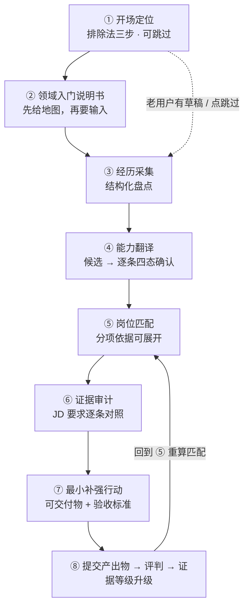
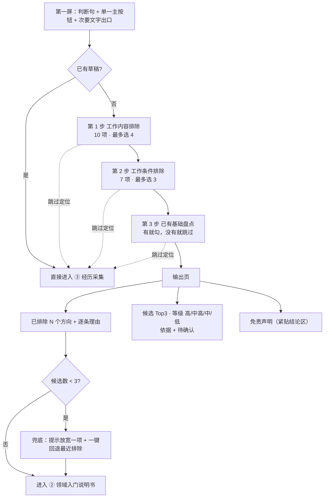
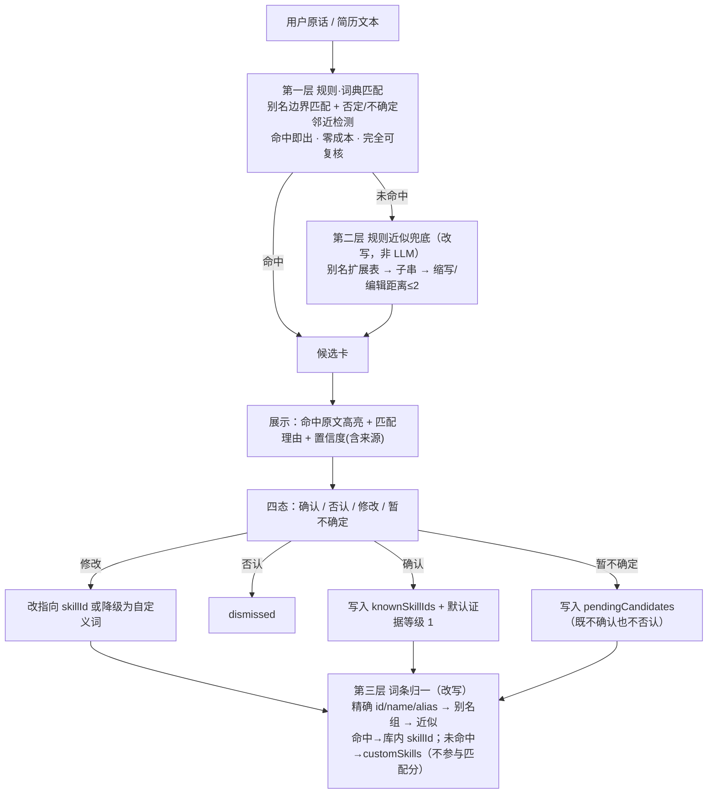
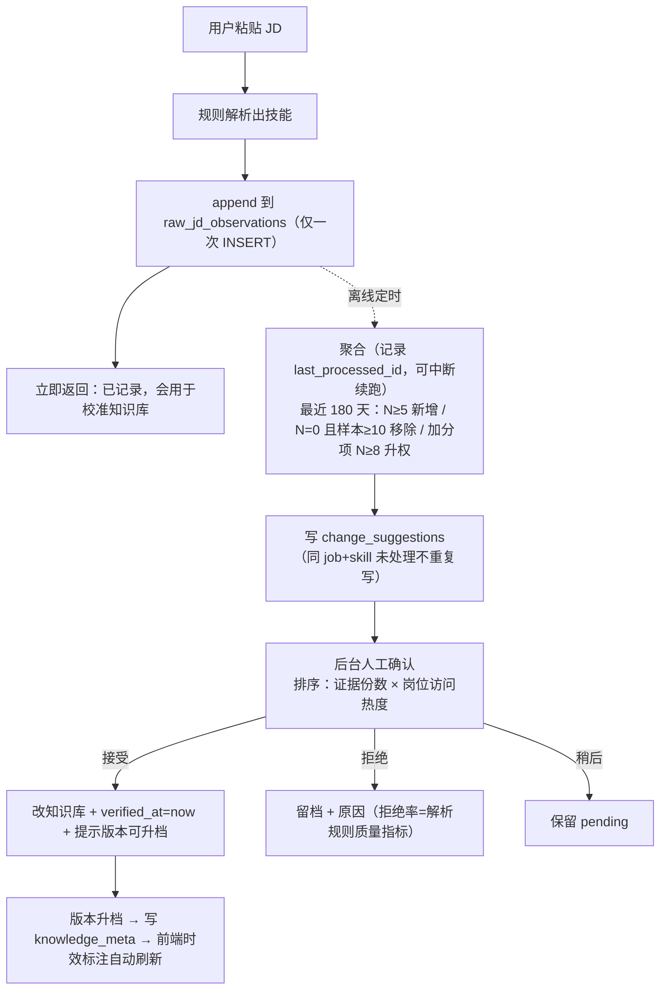

# 职途 · 增量 PRD v0.1

> 类型：**增量 PRD**（只描述变更，不重述已实现功能）
> 来源：《职途-产品设计说明-v0.1》全量落地
> 编写：产品经理 许清楚（Xu）· 2026-09-26
> 面向：架构师 / 实现工程师
> 语言：中文

---

## 0. 项目信息

| 项 | 值 |
| --- | --- |
| Project Name | `career-navigator` |
| 技术栈 | 沿用现有：Next.js（App Router）+ TypeScript + `node:sqlite` + Tailwind；**不引入新框架** |
| 交付形态 | 增量改造现有 `/plan` 主流程 + 新增开场章节 + 新增时效/闭环能力 |
| 硬约束 | ① 运行时**零 LLM** ② 不破坏现有已验证流程 ③ 数据库迁移沿用 `ALTER TABLE ... ADD COLUMN` 兼容写法 ④ 定位不变（只做在校大学生 / 给坐标不给结论 / 不预测录用概率） |

### 0.1 原始需求复述

把《职途-产品设计说明-v0.1》第 2–8 节全部落地为可执行需求：新增「开场定位 + 领域入门说明书」前置章节、把能力翻译的三层流水线**改写成纯规则形态**、把「技能 = 可交付物 + 验收标准」覆盖到全部 109 个技能、把验收评判的四层设计**改写成零 LLM 规则层**、建立知识库时效体系（三层节奏 + freshness 纯函数 + 时效展示 + 众包变更建议流程）、落地第 7 节数据结构与第 8 节「数据结构前置」。

### 0.2 本轮不做（明确排除）

- 不接任何大模型 API（含本地模型、embedding、OCR）。设计说明第 4 节的 LLM 兜底层**本轮不实现**，见第 7 节路线图。
- 不做竞品分析（设计说明 1.5 已明确不做通用 AI 聊天框，竞品分析对本轮无价值）。
- 不实现众包**聚合逻辑与后台确认界面**（设计说明 8.2 明确「只需要表存在」），见 P2。
- 不实现简历面板导出、年度能力表、社区（只做数据结构前置，见 P0-9）。

---

## 1. 产品目标

1. **让迷茫的人先拿到地图，再回答问题。**
   把「先索取（上传简历 / 勾技能）→ 再给结论」反转为「先给（领域地图 / 排除法定位）→ 再取（经历与基础）」。
   *衡量*：新用户在「动手验证」前看到的**自己输入以外的信息**（方向候选 + 排除理由 + 领域说明书）不少于 3 处。

2. **让「培养能力」这句话可兑现。**
   把每个技能的「补齐周期」从虚的数字变成**可核对的交付物 + 验收标准**，并让「做完 → 提交 → 评判 → 证据等级上升 → 匹配分重算」形成闭环。
   *衡量*：109 个技能 100% 能解析出非空 `deliverable` + `acceptance` + `requiredElements`；证据等级升级由**纯函数**给出，且用户可逐条推翻。

3. **让「数据可能过时」变成用户看得见的事实，而不是我们藏在心里的风险。**
   三层数据各按各的节奏维护；时效状态由时间戳 + 纯函数实时算出；后台复核队列按陈旧度排序。
   *衡量*：前端所有时效文案 100% 来自 `lib/freshness.ts` 两个纯函数（零硬编码）；`verified_at` 无任何批量标记入口。

---

## 2. 用户故事

1. **As a** 完全不知道去哪的大三学生 **, I want** 用「我确定不想要什么」来排除方向，并且看到系统**真的排除了哪些、为什么排除** **, so that** 我不需要先做一次我并不擅长的自我归类，也能得到一个起点。

2. **As a** 说不清自己能力对应什么岗位的学生 **, I want** 在回答「我有什么」之前先看到一份领域入门说明书（这行在做什么、行话怎么说、多久能入门、有什么硬门槛） **, so that** 我才有词去描述我做过的事。

3. **As a** 写了一段经历但被规则识别漏掉/误判的学生 **, I want** 每条候选能力都能看到「命中我原话的哪一句 + 匹配理由 + 置信度」，并且能**确认 / 否认 / 修改 / 暂不确定** **, so that** 最终的画像是我自己认过的，而不是系统猜的。

4. **As a** 想补一项技能的学生 **, I want** 系统告诉我「做什么交付物 + 什么算通过验收」，做完提交后**看到我的证据等级和匹配分真的变了** **, so that** 我的投入有可核对的产出，而不是打卡。

5. **As a** 用户 **, I want** 在每一个数字旁边看到它的口径（样本量 / 数据日期 / 复核时间） **, so that** 我能判断这个结论现在还能不能信。

---

## 3. 需求池

优先级：**P0 = Must have（本轮必须）** / **P1 = Should have（本轮尽量）** / **P2 = Nice to have（可下一轮）**。

### 3.1 P0 — 开场定位章节（设计说明第 3 节）

| # | 需求 | 验收标准 |
| --- | --- | --- |
| P0-1 | 新增**第一屏**：判断句 + 单一主按钮 + 次要文字出口 + 数据版本标注 | ① 第一屏**无输入框**；② 主按钮只有 1 个（「开始定位 · 约 3 分钟」）；③ 次入口为小字链接、视觉重量明显更低；④ 页脚数据版本行显示「133 岗 / 13 方向 · 数据版本 {version} · 人工整理，可复核」，版本号取自 `DATA_META.version`，**不硬编码** |
| P0-2 | 第 1 步「工作内容排除」：10 个选项（**真实体感文案**）、多选上限 4 | ① 每个选项文案为「工作的真实体感」句式，禁止中性描述（对照设计说明 3.3 的 ❌/✅ 表逐条核对）；② 选满 4 项后其余选项禁用并提示；③ 勾选即时可见「将被排除的方向」预览；④ 排除依据来自 `job_work_tags` 的 `tier='core'` 行（见 4.1），**不是硬编码一对一映射** |
| P0-3 | 第 2 步「工作条件排除」：7 个选项、多选上限 3 | ① 与第 1 步选项**无重复语义**（第 1 步问「做什么」、第 2 步问「怎么工作」）；② 页面显式说明「这是给你自己看的筛选条件，不是承诺」；③ 排除依据来自 `job_work_tags` 的 `tier='core'` 行 |
| P0-4 | 第 3 步「已有基础盘点」（取，非排） | ① 文案为「有就勾，没有就跳过」，**绝不出现「你不会什么」**；② 含专业大类（下拉）/ 技能基础（多选，映射见 4.3）/ 经历类型（课程项目·竞赛·社团·实习·兼职·个人作品·无）/ 每周可投入（5 / 10 / 20 / 30+）；③ 全部为选填，可直接跳过 |
| P0-5 | **输出页** | ① 「已排除」区**必须展示且写明理由**（逐条：方向名 + 「你不想做 XX 类工作」）；② 候选 Top 3 用**等级**「高 / 中高 / 中 / 低」，**禁止出现百分比**；③ 每个候选含「依据」与「待确认」两栏；④ 免责声明（「这是基于你偏好与基础的初筛，不是能力评估」）**紧贴结论区**，不放页脚 |
| P0-6 | 开场硬约束与兜底 | ① 每题选项 ≤10；② **允许全不选**（= 不排除任何方向，正常进入下一步）；③ **不允许全选**：全选时阻断并提示「你排除了所有方向，要不要放宽一项？」；④ 排除后候选 < 3 时给出兜底提示并允许一键回退最近一项排除；⑤ **空结果绝不出现** |
| P0-7 | **开场可跳过**（硬约束 2） | ① 已存在草稿的用户（`started === true`）**不经过开场**，直接进原 `step 0`；② 新用户在第一屏有「已经想清楚了？直接选方向」文字出口；③ 开场内任一步有「跳过定位」链接，点击后 `orientation.skipped = true` 并进入原流程；④ 跳过不影响任何原流程断言 |
| P0-8 | 视觉与表达规范（设计说明 3.6）落地为**可检查清单** | ① 无渐变 / 无插画 / 无 emoji；② 步骤用 `01 / 02 / 03` 编号；③ 用表格与清单，**不用卡片流**；④ 每个数字旁带口径标注（样本量 / 数据日期 / 版本）；⑤ 等级只用「高/中高/中/低」；⑥ 配色一个主色 + 中性灰阶，**红色仅用于「硬门槛未满足」，绿色仅用于「已验证」**（新增色值需登记在此清单，不得引入第三种语义色） |

### 3.2 P0 — 领域入门说明书（设计说明第 2 节第 ② 步）

| # | 需求 | 验收标准 |
| --- | --- | --- |
| P0-9 | 新增「领域入门说明书」视图，置于经历采集**之前** | ① 按字段模板渲染（见 4.4）：领域一句话 / 子方向 / 核心术语表 / 入门周期 / 硬门槛 / 数据口径；② 数据来自 `tracks` 扩展字段，**前端零硬编码文案**；③ 每个说明书页展示「复核时间 + 样本量 + confidence」（时效纯函数渲染）；④ 提供「换一个方向看看」与「直接开始记录经历」两个出口；⑤ 从开场输出页点候选方向可直达对应说明书 |

### 3.3 P0 — 能力翻译改为**纯规则三层**（设计说明第 4 节 + 硬约束 1）

> **改写说明**：设计说明 4.1 的三层流水线中，第二层「LLM 兜底」本轮**不实现**，改由**规则近似兜底**承担；第三层「规则清理 LLM 输出」改由**用户手动补充能力时的词条归一逻辑**承担。LLM 方案见第 7 节路线图，明确标注**未实现**。

| # | 需求 | 验收标准 |
| --- | --- | --- |
| P0-10 | **第一层**：规则 / 词典匹配（已实现，保持） | 沿用 `detectSkillsDetailed` + `findSkillAliasOccurrences`：命中即出结果；拉丁别名按词边界（Java 不命中 JavaScript、SQL 不命中 NoSQL）；否定 / 学习中 / 经验有限的邻近表述不自动计入 |
| P0-11 | **第二层（改写）**：规则近似兜底 | ① 新增 `lib/skill-fallback.mjs` 纯函数，**不含任何网络请求**；② 依次尝试：**别名扩展表**（同义 / 近义 / 俗称，如「取数 / 拉数 / 查数」→ `sql`）→ **子串包含** → **缩写与编辑距离 ≤2 的近似**（仅对拉丁词条）；③ 输出必须带 `source: 'exact-alias' | 'alias-group' | 'substring' | 'fuzzy'` 与 `confidence: 'high' | 'medium' | 'low'`；④ **兜底结果只提候选，绝不自动勾选**（与第一层一致）；⑤ 单测覆盖：别名扩展命中、子串命中、fuzzy 命中、fuzzy 误命中防护（如 `java` 与 `javascript` 不得互相近似命中） |
| P0-12 | **第三层（改写）**：词条归一逻辑 | ① 用户手动补充能力时，按 `精确 id → name → alias → 别名组 → 近似` 顺序归一；② 命中 → 映射到库内 `skillId` 并参与匹配分；③ 未命中 → 写入 `customSkills`，**只作记录、不参与匹配分**，并明确提示；④ **任何路径都不得把库外词条当作 `skillId` 写入**（`skillId` 白名单校验在 `matcher` 与 API 两侧各做一次） |
| P0-13 | **候选卡四态按钮**（设计说明 4.4） | ① 每条候选展示：**命中原文（高亮片段）** + 匹配理由 + 置信度（含来源）；② 四态：**确认 / 否认 / 修改 / 暂不确定**；③ 「修改」可选择另一个 `skillId` 或降级为自定义词；④ 「暂不确定」写入 `profile.pendingCandidates`，**既不确认也不否认**，候选卡保留可回看；⑤ 命中原文为空时不得展示为「已具备」，必须显示「暂无从佐证」 |

### 3.4 P0 — 可交付物与验收闭环（设计说明第 5 节 + 硬约束 1）

| # | 需求 | 验收标准 |
| --- | --- | --- |
| P0-14 | **技能 = 可交付物 + 验收标准**，覆盖全部 109 技能 | ① `matcher.actionTemplate()` 改为三级解析：`skill.action` → 分类默认模板 → 通用兜底（见 4.6）；② **109 个技能 100% 解析出非空 `deliverable` + `acceptance`**；③ 移除当前硬编码 7 条的写法，7 条原值迁入数据文件；④ `scripts/data/validate-data.mjs` 新增校验：任一技能无法解析 → 退出码 1 |
| P0-15 | **验收评判四层 → 零 LLM 规则层**（设计说明 5.3 改写） | ① 提交产出物时先确定 `deliverableType`（系统按技能带入，用户可改）；② 系统按类型列出 `requiredElements` 清单；③ **规则层**做轻量文本检测（可机器检测项，如「行数变化」→ 数字 + 量词正则；「数据来源」→ 是否含 URL / 文件路径 / 文件名），命中则**预勾选**并标注「规则检测到」；未命中提示「未检测到，请人工确认」；④ 用户逐条自评「有 / 无 / 不确定」；⑤ **规则层输出证据等级建议值**（纯函数，见 4.7），LLM 不参与；⑥ 用户可**逐条推翻**等级；⑦ 提供「申请复核」入口（零 LLM 下 = 标记为「待线下确认」并进入个人待办） |
| P0-16 | 评判结果展示「我看了你的什么」 | ① 每条判定必须回显依据：规则检测命中的**原文片段/文件名**，或明确标注「用户自述，未经规则检测」；② 不得出现无依据的「有证据」结论 |
| P0-17 | **闭环形状**（设计说明 5.4） | ① 完成行动 → 提交产出物 → 评判 → 证据等级升级 → **重算匹配分** → 回到方向比较（`navigate(2)`）；② 升级后匹配分变化必须**可见**（展示「技能覆盖 X% → Y%」「项目证据覆盖 X% → Y%」）；③ **防作弊**：产出物必须含可核对材料（`artifactLocation` 非空）且含 `requiredElements`，纯文字描述不计入等级 4 |
| P0-18 | 修正现有不一致 | 现状 `PathView` 与 `README` 都写着「完成行动不自动提升技能或证据等级」。本 PRD 后：**勾选完成**仍不自动提升；**提交产出物并通过规则层评判**才提升。两处文案必须同步改写，避免自相矛盾 |

### 3.5 P0 — 知识库时效（设计说明第 6 节）

| # | 需求 | 验收标准 |
| --- | --- | --- |
| P0-19 | `lib/freshness.ts` 纯函数 | ① 导出 `getFreshness(verifiedAt, now)` 与 `formatVerifiedAt(verifiedAt, now)`，签名与设计说明 6.3 一致；② 状态四档：`fresh` <90d / `referenceable` <180d / `needs_review` <365d / `outdated` ≥365d；③ 展示格式按陈旧度切换（近期相对、超阈值绝对）；④ 纯函数、零副作用、**单测覆盖 4 个边界（89/90/180/365 天）** |
| P0-20 | 时效展示接入前端 | ① 岗位卡 / 技能卡 / 领域说明书 / 数据版本页展示「X 天前复核」；② 文案**100% 来自 `formatVerifiedAt`**，前端零硬编码时效字符串；③ 后台改一条数据 → `verified_at = now()` → 前端下次渲染自动变「今天复核」 |
| P0-21 | 三层数据节奏说明 | ① 在数据与边界页按 A/B/C 三层分别展示：A 技能本体（一年一次全面复核）/ B 岗位×技能权重与门槛（每季度抽 10–15 个热门岗位人工核对）/ C 市场事实（外部报告 + 众包，**必须标注时间**）；② 每层展示当前 `verified_at` 分布（多少条 fresh / needs_review / outdated） |
| P0-22 | 时效驱动后台复核队列 | ① 后台列表支持按「陈旧度 + 访问频次」排序；② 该排序**不新增写路径**（纯读 + 排序）；③ 页面标注「这是给你看的待办清单」 |
| P0-23 | `verified_at` 防自我欺骗 | ① **不得存在**任何批量「标记为已复核」入口（按钮 / API / SQL 脚本）；② 单条复核必须显式确认并写入具体时间；③ 该项纳入代码审查清单 |

### 3.6 P0 — 数据结构前置（设计说明第 7、8 节）

| # | 需求 | 验收标准 |
| --- | --- | --- |
| P0-24 | 新建 `knowledge_meta` 表 | 按设计说明 7.1 DDL；`version` / `published_at` / `notes`；后台发布版本时写入；前端数据版本展示读取此表 |
| P0-25 | `jobs` / `skills` 各加 5 列 | `source_date` / `updated_at` / `verified_at` / `sample_size` / `confidence`；迁移沿用 `PRAGMA table_info` + `ALTER TABLE ... ADD COLUMN` 兼容写法，**老库升级后不丢数据** |
| P0-26 | `confidence` 定义写死 | `high` = 样本 ≥15 份 JD 且经人工确认；`medium` = 5–15 份；`low` = <5 份。**该校验在 `validate-data.mjs` 与后台表单双向执行**（`sample_size` 与 `confidence` 必须自洽） |
| P0-27 | 新建 `raw_jd_observations` 表（只增不改） | 按设计说明 7.3 DDL + 索引 `idx_obs_job(job_id, created_at)` |
| P0-28 | 新建 `change_suggestions` 表（不自动改库） | 按设计说明 7.4 DDL |
| P0-29 | **数据结构前置，不是空框架**（设计说明附录 B） | ① `jobs` / `skills` / `tracks` 的新字段**本轮就填真实数据**（`source_date` / `verified_at` / `sample_size` / `confidence` / 领域说明书字段 / 交付物字段），只是 UI 可以不全部展示；② 交付验收时抽查 ≥10 条，字段值非空且与 `sample_size`/`confidence` 自洽；③ **禁止**把「表存在但全为 NULL」当作完成 |
| P0-30 | 简历面板导出 / 年度能力表 / 社区的数据结构前置（设计说明 8.1） | ① 每条能力带「证据文本 + 量化结果」字段（`evidenceText` / `evidenceResult`）；② 每条经历与每条评判记录存**时间戳**；③ 产出物记录设计成「可展示」形态（标题 / 位置 / 个人贡献 / 时间戳）；④ 本轮**不实现**这三个 UI |

### 3.7 P1 — 本轮尽量

| # | 需求 | 验收标准 |
| --- | --- | --- |
| P1-1 | 用户粘贴 JD 时异步记录观察（设计说明 6.4 ①） | ① 请求路径上**只有一次 INSERT**，**绝不出现聚合查询**；② 用户侧无感，立即返回「已记录，会用于校准知识库」；③ 写入 `raw_jd_observations`（含 `text_hash` 去重）；④ 该能力**可关闭**，关闭后不影响 JD 解析与保存 |
| P1-2 | `data/exclusions.json` + `job_work_tags` 落真实数据 | ① 10 个内容 tag + 7 个条件 tag 全部有定义；② 133 个岗位中**每个岗位至少 1 条 `tier='core'` 的内容 tag**；③ 每个 tag 至少被 3 个岗位引用（否则该选项无意义）；④ 每个 tag 覆盖岗位比例 ≤ 60%（否则等于全排除，触发校验失败） |
| P1-3 | `scripts/data/validate-data.mjs` 扩展 | 新增校验：tag 白名单、`job_work_tags` 引用完整性、tag 覆盖率上下限、`confidence` 与 `sample_size` 自洽、109 技能可解析交付物、`starterSkills` 的 `skillIds` 全部存在、`tracks` 说明书字段非空。**全部零错误才 PASS** |
| P1-4 | 经历采集字段扩展（见 4.5） | ① 新增 `title` / `partTags` / `hasDeliverable` / `deliverableNote` / `experienceType` / `timeline`；② `experiences` 合并文本行为**保持不变**（`detectSkills` 输入不受影响）；③ 老画像（无新字段）读取不报错、不丢数据 |
| P1-5 | 开场输出页候选**等级**由规则计算 | ① `level ∈ {高, 中高, 中, 低}`，由「未被排除的 tag 匹配数 + 已勾选基础命中的技能权重」纯函数得出；② **禁止输出百分比**；③ 单测覆盖等级边界 |

### 3.8 P2 — 可下一轮

| # | 需求 | 验收标准 |
| --- | --- | --- |
| P2-1 | 离线聚合任务 → `change_suggestions`（设计说明 6.4 ②） | ① 记录 `last_processed_id`，**可中断续跑**；② 阈值按设计说明（库里没有且 N≥5 → `add`；库里有且 N=0 且样本≥10 → `remove`(low confidence)；加分项且 N≥8 → `upgrade_weight`）；③ 同一 `job+skill` 未处理不重复写 |
| P2-2 | 后台变更建议确认界面（设计说明 6.4 ③） | ① 按「证据份数 × 岗位访问热度」排序；② 每条显示岗位 / 技能 / 建议类型 / 证据份数，**可展开看原始 JD 片段**；③ 操作 `[接受] [拒绝] [稍后]`；④ 接受 → 改知识库 + `verified_at = now()` + 提示版本可升档 |
| P2-3 | 「拒绝也是数据」（设计说明 6.7） | ① 拒绝留档并**记录原因**；② 拒绝率按建议类型统计，作为解析规则质量指标展示在后台；③ 同一错误建议不得反复出现 |
| P2-4 | 版本升档流程（设计说明 6.4 ④） | ① 累积到阈值 → 提示「知识库可发布 v3.2」；② 发布 → 写 `knowledge_meta` → 前端所有时效标注自动刷新 |
| P2-5 | `raw_jd_observations` 365 天归档 | ① 超期记录可压缩或删除，**只留 `parsed_skills` 与 `hash`**；② 归档任务独立、可中断、不阻塞请求路径 |

---

## 4. 字段与数据定义

> 本节回答设计说明 9.3 全部「待补充设计」，给出**可核对的数据定义**，供架构师直接落数据。

### 4.1 开场排除：选项 → 岗位映射（回答 9.1）

**问题**：设计说明 9.1 自承「选项 → 方向映射表是手写的、很可能不准」，实际是**多对多**，且要区分**核心日常（该排除）**与**偶尔涉及（不该排除）**。

**结论（可执行定义）**：

1. **权威数据放在岗位侧，选项侧只放 tag 定义。** 一对一映射表被废弃，改为 `tag` 匹配。
2. **映射表独立成表**，用 `tier` 列显式区分两档——`incidental` 行**不参与排除**，但可用于展示「该方向偶尔涉及，未排除」，这正是 9.1 要求的两档区分。

**新文件 `data/exclusions.json`**：

```jsonc
{
  "_meta": { "version": "1.0", "note": "开场排除法选项 → tag 定义。tag 由 jobs.json 的 workTags 引用。" },
  "contentOptions": [          // 第 1 步：工作内容排除，10 项，多选上限 4
    { "id": "high-freq-outbound",   "tag": "high-freq-outbound",   "label": "每天要打几十个电话，被拒绝是常态",        "reason": "你不想做高频外联与说服类工作" },
    { "id": "data-check-heavy",     "tag": "data-check-heavy",     "label": "一整天盯着表格找异常、核对口径，错了要担责", "reason": "你不想做数据处理与核对类工作" },
    { "id": "code-debug",           "tag": "code-debug",           "label": "花大段时间卡在一个 bug 上，反复试错",       "reason": "你不想写代码调试" },
    { "id": "visual-rework",        "tag": "visual-rework",        "label": "反复改稿，需求方一句话就推翻重做",         "reason": "你不想做视觉产出与反复迭代类工作" },
    { "id": "doc-alignment",        "tag": "doc-alignment",        "label": "写几万字的文档，还要反复对齐口径",         "reason": "你不想做文档撰写与跨方对齐类工作" },
    { "id": "emotional-labor",      "tag": "emotional-labor",      "label": "整天被用户的情绪冲着，还要保持礼貌",       "reason": "你不想做情绪劳动为主的工作" },
    { "id": "research-experiment",  "tag": "research-experiment",  "label": "大量时间读论文、跑实验，多数尝试是失败的", "reason": "你不想做实验与试错为主的工作" },
    { "id": "detail-audit",         "tag": "detail-audit",         "label": "逐条核对细节，出了错要担责",               "reason": "你不想做质量核查类工作" },
    { "id": "coordination-chase",   "tag": "coordination-chase",   "label": "追着多方要进度，天天协调冲突",             "reason": "你不想做协调推进类工作" },
    { "id": "changing-requirements","tag": "changing-requirements","label": "需求天天变，做完的东西可能被整个砍掉",     "reason": "你不想应对持续变化的需求" }
  ],
  "contextOptions": [          // 第 2 步：工作条件排除，7 项，多选上限 3
    { "id": "frequent-travel",   "tag": "frequent-travel",   "label": "频繁出差（每月超过 1 次）",   "reason": "你接受不了频繁出差" },
    { "id": "overtime-weekend",  "tag": "overtime-weekend",  "label": "长期加班、周末待命",         "reason": "你接受不了长期加班与周末待命" },
    { "id": "drinking-social",   "tag": "drinking-social",   "label": "需要喝酒应酬、维护人情关系", "reason": "你接受不了应酬类社交" },
    { "id": "repetitive-process","tag": "repetitive-process","label": "高度重复、流程固定的工作",   "reason": "你接受不了高度重复的流程化工作" },
    { "id": "onsite-only",       "tag": "onsite-only",       "label": "必须到公司坐班，不能远程",   "reason": "你接受不了必须坐班" },
    { "id": "commission-income", "tag": "commission-income", "label": "收入波动大、靠业绩提成",     "reason": "你接受不了收入靠提成" },
    { "id": "changing-goals",    "tag": "changing-goals",    "label": "目标经常变、长期面对不确定性","reason": "你接受不了目标频繁变化" }
  ]
}
```

**`data/jobs.json` 每个岗位新增字段 `workTags`**（唯一真源）：

```jsonc
{
  "id": "data-analyst",
  "title": "数据分析师（业务方向）",
  "workTags": [
    { "tag": "data-check-heavy", "tier": "core",       "note": "核心职责为取数与口径核对；依据 summary + core 技能构成" },
    { "tag": "doc-alignment",    "tier": "incidental", "note": "需输出分析报告，但非主要工时；依据 summary" },
    { "tag": "changing-requirements", "tier": "incidental", "note": "业务口径会变；依据 threshold" }
  ]
}
```

**判定口径（写进 `data/exclusions.json._meta` 与维护手册，必须逐条可追溯）**：

| tier | 判定标准 | 必填 |
| --- | --- | --- |
| `core` | 该活动占该岗位日常工作时间的主要部分（经验口径 **≥30%**），**或**该项做不好直接导致产出不合格 / 被追责 | `note` 必须写明依据来源（`summary` / `core` / `threshold` / `growth` / 真实 JD 职责描述） |
| `incidental` | 岗位会涉及但非主要职责（**<30%** 工时，且不决定产出成败） | 同上；`incidental` 行**永不触发排除** |

**排除算法（纯函数，放 `lib/orientation.ts`）**：

```
输入：勾选的 contentOptions[]、contextOptions[]
① tagIds = 勾选项对应的 tag 集合
② excludedJobIds = jobs.filter(j => j.workTags.some(t => t.tag ∈ tagIds && t.tier === 'core')).map(j => j.id)
③ 方向级聚合：对每个 track，ratio = 该方向被排除岗位数 / 该方向岗位总数
     ratio ≥ TRACK_EXCLUDE_RATIO(0.6) → 标「已排除」
     0 < ratio < 0.6                  → 标「部分相关，未整体排除」（透明展示）
     ratio = 0                        → 保留
④ 兜底：若候选方向数 < 3 → 提示「要不要放宽一项？」并允许一键回退最近一项排除
```

**为什么这样能修正 9.1 的错误**：多对多天然成立（一个岗位多个 tag、一个 tag 多个岗位）；两档由 `tier` 显式表达；依据可逐条追溯（`note`）；且**误伤可被数据校验拦住**（见 P1-2 的覆盖率上下限）。

**必须一并处理的发现（数据校准风险，交架构师与内容维护者核对）**：
设计说明 3.3 第 1 步的「勾选后排除」列写的是 `销售 / 商务 / 客户成功`、`数据分析 / 财务 / 审计`、`客服 / 社群运营`、`测试 / 审计 / 风控`。但现有 13 个方向为 `ai / data / algorithm / frontend / backend / qa / product / operation / design / security / game / mobile / infra`，**库内不存在「销售」「财务」「审计」「风控」「客服」方向**。
→ 处理方式：**不新增方向**（设计说明 1.5 明确「不盲目扩充岗位数量」）。改为按 `job_id` 精确映射到现有岗位，例如：
- `high-freq-outbound` → `ops-bizdev`(BD) / `ops-sem`(投放) / `ops-cx`(用户成功) / `ops-growth`
- `data-check-heavy` → `data-analyst` / `bi-engineer` / `data-quality` / `analytics-eng` / `growth-data` / `user-analytics` / `bi-consultant`
- `detail-audit` → `qa-*` 全系列 / `security-analyst` / `data-quality`
- `emotional-labor` → `ops-cx` / `ops-user`
- 无对应岗位的选项（若落数据后某 tag 引用岗位数为 0）→ **该选项不上线**，或改写文案使其对应库内真实存在的工作内容。

### 4.2 第 2 步「工作条件排除」7 选项 → 岗位字段映射

**结论**：与 4.1 同机制，复用 `workTags` + `tier`。7 个 tag 见 4.1 的 `contextOptions`。

**额外要求**：

1. 条件 tag 的判定**不可从现有字段直接推导**，因此必须：
   - 每条 `core` 级条件 tag 的 `note` 写明判定来源（真实 JD / 行业公开描述 / `threshold`）；
   - 后台对条件 tag 单独提供「待校准」标记 `reviewStatus: 'confirmed' | 'assumed'`；
   - 前端展示排除理由时，`assumed` 行必须附「（此项为人工初判，待校准）」。
2. 条件排除**不得单独把候选清空**：若「仅按条件排除」后候选 < 3，则条件排除降级为**排序权重**（不硬排除），并在输出页说明「这些条件影响了排序，但没有直接排除方向」。

### 4.3 第 3 步技能基础清单 ↔ `skills.json` 入门级技能（回答 9.3）

**结论**：设计说明的 9 个起步项与 109 个技能**不是一对一**（部分是技能组），因此定义一份独立映射文件，可被校验。

**新文件 `data/starter-skills.json`**：

```jsonc
{
  "_meta": { "version": "1.0", "note": "开场第 3 步「技能基础」勾选项 → 库内 skillId 映射。skillIds 必须全部存在于 skills.json。" },
  "items": [
    { "id": "excel",        "label": "Excel / 表格处理",       "skillIds": ["excel"] },
    { "id": "sql",          "label": "SQL / 数据库查询",       "skillIds": ["sql"] },
    { "id": "programming",  "label": "Python 或其他编程语言",  "skillIds": ["python", "java", "golang", "js", "ts", "cpp"] },
    { "id": "dataviz",      "label": "数据可视化",             "skillIds": ["data-viz", "bi-tools"] },
    { "id": "stats",        "label": "统计与概率",             "skillIds": ["stats"] },
    { "id": "writing",      "label": "文案写作",               "skillIds": ["doc-writing", "content-plan"] },
    { "id": "media-edit",   "label": "图片视频编辑",           "skillIds": ["visual-design", "motion-design"] },
    { "id": "prototype",    "label": "原型设计工具",           "skillIds": ["prototype"] },
    { "id": "english",      "label": "英语读写",               "skillIds": ["tech-english"] }
  ]
}
```

**落地规则**：

| 项 | 规则 |
| --- | --- |
| 勾选 → 画像 | 勾选某 `item` → 把其 `skillIds` **预勾选**进 `knownSkillIds`（用户仍可在能力翻译页移除） |
| 默认证据等级 | **默认 `2`（课程或练习）**，理由：「有基础」这一表述本身接近「上过课/做过练习」。UI 必须标注「自评，可调」，且用户可下调至 1 或上调 |
| 校验 | `validate-data.mjs`：每个 `item.skillIds` 非空、全部存在于 `skills.json`、`item.id` 唯一 |
| 待校准 | `media-edit`：库内**没有**专门的「图片视频编辑」技能，当前借用 `visual-design` / `motion-design`。建议二选一：**（a）** 新增 1 个技能 `media-editing`（含 aliases：剪辑 / 修图 / PS / PR / 剪映），**（b）** 接受借用映射并在 UI 标注。**默认按 (b) 实现，作为待确认问题 Q3** |

### 4.4 领域入门说明书字段模板（回答 9.3）

**落地位置**：`data/jobs.json` 的 `tracks[]` 扩展（现有 `tracks` 只有 `id` / `name`）。

```jsonc
{
  "id": "data",
  "name": "数据",
  "oneLiner": "把散在各处的数据整理成能被业务直接用的结论。",
  "subDirections": ["数据分析", "数据开发", "数据治理"],       // 子方向（纯文本，可与 job.track 下的岗位名对齐）
  "glossary": [                                              // 核心术语表：术语 + 人话解释
    { "term": "口径",       "plain": "同一个指标到底怎么算，先约定清楚再统计" },
    { "term": "ETL",        "plain": "把数据从多个来源搬到一个地方并整理好" },
    { "term": "指标拆解",   "plain": "把一个大指标拆成几个能分别优化的小指标" }
  ],
  "entryCycle": "3–6 个月可独立完成基础取数与报表（按每周 10 小时估算，不是承诺）",
  "hardThresholds": ["多数岗位要求 SQL；纯 Excel 岗位正在减少", "校招普遍要求至少一段数据相关项目或实习"],
  "dataNote": "本说明基于库内 12 个数据方向岗位的模板整理；岗位要求为参考模板，不代表某家公司实际要求。",
  "verifiedAt": "2026-09",        // 最后人工复核，供 freshness 纯函数
  "sampleSize": 12,               // 基于库内几个岗位整理
  "confidence": "medium"
}
```

| 字段 | 必填 | 口径 / 校验 |
| --- | --- | --- |
| `oneLiner` | 是 | 一句话，≤40 字，非空 |
| `subDirections` | 是 | 数组，≥1 项，且必须与库内真实岗位方向一致（不得编造） |
| `glossary` | 是 | ≥5 条（术语 + 人话解释）；`plain` 不得复述 `term` |
| `entryCycle` | 是 | 必须写明「按每周 X 小时估算，不是承诺」 |
| `hardThresholds` | 是 | 数组，可空数组（空 = 明确说明「无明显硬门槛」），非空时每项必须可追溯到 `jobs.threshold` 或真实 JD |
| `dataNote` | 是 | 必须写明样本量与「不代表某家公司实际要求」 |
| `verifiedAt` / `sampleSize` / `confidence` | 是 | 与 `jobs` 同口径；`confidence` 定义见 P0-26 |

**展示规则**（先给地图）：说明书在经历采集前展示；术语表必须**可直接复制**（用户拿它去描述自己的经历）；每个数字旁带口径标注。

### 4.5 经历采集字段定义（回答 9.3）

**现状**：`Profile.experienceParts = { what, part, tools, problem, result }`，`experiences` 为合并文本。

**扩展（全部可选，向后兼容）**：

```ts
// lib/types.ts
export interface ExperienceParts {
  title?: string;          // 新增：项目 / 经历名称（如「社团问卷调研」）
  what: string;
  part: string;            // 保留：负责部分的自由描述
  partTags?: string[];     // 新增：负责部分多选（见下表）
  tools: string;
  problem: string;
  result: string;
  hasDeliverable?: "yes" | "no" | "unsure";  // 新增：有无交付物
  deliverableNote?: string;                  // 新增：交付物说明（hasDeliverable==='yes' 时展示）
}

// Profile 新增
experienceType?: "course" | "competition" | "club" | "internship" | "parttime" | "personal" | "none";
experienceTimeline?: string;   // 新增：发生时间（如 "2025 秋"），为年度能力表前置（设计说明 8.1）
```

**`partTags` 选项（多选，取自现有 `data/skills.json` 的高频技能，避免新增词表）**：

| partTag | 中文 | 映射 skillId |
| --- | --- | --- |
| `data` | 数据整理与统计 | `excel`, `sql`, `stats`, `data-clean` |
| `code` | 写代码 / 做功能 | `python`, `js`, `ts`, `node`, `html-css` |
| `design` | 视觉 / 交互设计 | `ui-design`, `prototype`, `visual-design` |
| `writing` | 写文档 / 写文案 | `doc-writing`, `content-plan` |
| `coordination` | 协调与推进 | `project-mgmt`, `structured-expression` |
| `research` | 调研与分析 | `user-research`, `data-driven` |
| `operation` | 运营执行 | `community`, `growth` |
| `other` | 其他（自由填写） | — |

**约束**：

1. **`experiences` 合并文本行为必须不变**（`what/part/tools/problem/result` 按原顺序 `\n` 连接），确保 `detectSkills` 输入不受影响、现有测试与 `verify-*.mjs` 不回归。
2. 新字段**不参与**技能识别文本（避免把勾选项当成用户原话，违反「命中原文」原则）。
3. 老画像无新字段时，读取走默认值，**不报错、不丢数据**。
4. `experienceTimeline` 与 `ActionEvaluation.evaluatedAt` 是「年度能力表」的唯一前置，本轮只存不展示。

### 4.6 109 个技能的「可交付物 + 验收标准」批量定义（回答 9.3）

**问题**：现状 `matcher.actionTemplate` 只硬编码 7 个技能，其余走通用兜底 → 兜底文案对具体技能无指导意义。

**结论：三级解析 + 类型化必含要素**，把 109 条压缩成「13 个分类模板 + 10 种交付物类型 + 少量技能覆盖」。

**新文件 `data/deliverable-types.json`**（必含要素**按交付物类型**定义一次，而不是按技能定义 109 次——这正是 9.3 要求的「按交付物类型定义」）：

```jsonc
{
  "_meta": { "version": "1.0" },
  "types": {
    "report":      { "label": "分析报告",   "requiredElements": ["原始数据来源", "处理前后数量对比", "问题分类与处理理由", "可复现步骤或脚本"] },
    "script":      { "label": "可运行脚本", "requiredElements": ["输入样例", "运行说明", "异常处理", "至少 3 个边界测试"] },
    "dashboard":   { "label": "数据看板",   "requiredElements": ["数据来源与口径", "至少 3 个图表", "关键数字核对"] },
    "doc":         { "label": "文档",       "requiredElements": ["目标读者与目的", "结构化章节", "口径或术语说明", "版本与日期"] },
    "design":      { "label": "设计稿",     "requiredElements": ["设计目标与约束", "至少 2 版方案对比", "设计说明或标注"] },
    "repo":        { "label": "代码仓库",   "requiredElements": ["README", "可读的提交历史", "可复现运行步骤"] },
    "prototype":   { "label": "可交互原型", "requiredElements": ["核心流程可走通", "加载/空/错误三种状态", "可访问链接"] },
    "case-study":  { "label": "案例复盘",   "requiredElements": ["背景与问题", "个人贡献", "方法与过程", "结果与量化", "反思"] },
    "dataset":     { "label": "数据集",     "requiredElements": ["字段说明", "采集或清洗口径", "质量检查项", "许可与隐私说明"] },
    "other":       { "label": "其他作品",   "requiredElements": ["任务说明", "个人贡献", "可复现步骤", "结果记录"] }
  }
}
```

**新文件 `data/action-templates.json`**（分类默认模板，13 个分类各一条）：

```jsonc
{
  "_meta": { "version": "1.0" },
  "byCategory": {
    "基础":   { "deliverableType": "report",    "deliverable": "一份用到「{skill}」的可复现练习产出", "acceptance": "说明任务、个人贡献与实现过程；附可复现步骤与 3 条自查记录。" },
    "数据":   { "deliverableType": "report",    "deliverable": "一份含「{skill}」的真实数据分析产出", "acceptance": "含原始数据来源、处理前后对比、结论与口径说明。" },
    "AI":     { "deliverableType": "script",    "deliverable": "一个用到「{skill}」的可运行 AI 小项目", "acceptance": "含输入样例、运行说明、失败案例与效果对比。" },
    "前端":   { "deliverableType": "prototype", "deliverable": "一个用到「{skill}」的可访问交互页面", "acceptance": "核心流程可走通，含加载/空/错误状态与移动端布局。" },
    "后端":   { "deliverableType": "repo",      "deliverable": "一个用到「{skill}」的可运行服务或模块", "acceptance": "含 README、可复现启动步骤与接口/模块说明。" },
    "产品":   { "deliverableType": "doc",       "deliverable": "一份含「{skill}」的产品文档", "acceptance": "含目标用户、问题定义、方案取舍与衡量口径。" },
    "运营":   { "deliverableType": "case-study","deliverable": "一份含「{skill}」的运营案例复盘", "acceptance": "含背景、动作、数据结果与可复用结论。" },
    "软技能": { "deliverableType": "doc",       "deliverable": "一份展示「{skill}」的书面产出", "acceptance": "含结构化章节、受众说明与自我复盘。" },
    "设计":   { "deliverableType": "design",    "deliverable": "一套含「{skill}」的设计稿", "acceptance": "含设计目标、至少 2 版方案对比与设计说明。" },
    "安全":   { "deliverableType": "report",    "deliverable": "一份含「{skill}」的安全测试或分析报告", "acceptance": "含目标环境说明、发现清单、复现步骤与修复建议。" },
    "游戏":   { "deliverableType": "prototype", "deliverable": "一个含「{skill}」的可运行游戏原型", "acceptance": "含核心玩法可走通、操作说明与已知问题清单。" },
    "移动端": { "deliverableType": "repo",      "deliverable": "一个含「{skill}」的可运行移动端工程", "acceptance": "含 README、构建步骤与真机/模拟器运行截图。" },
    "基础架构": { "deliverableType": "repo",    "deliverable": "一套含「{skill}」的可复现环境或脚本", "acceptance": "含依赖说明、一键启动步骤与故障演练记录。" }
  }
}
```

**`skills.json` 每个技能新增字段 `action`（可选，用于覆盖分类默认）**：

```jsonc
{
  "id": "sql",
  "action": {
    "deliverableType": "report",
    "deliverable": "一份可复现的业务 SQL 分析报告",
    "acceptance": "包含关联查询、分组统计和窗口函数；附数据说明、查询脚本与结果核对。"
  }
}
```
> 现有 7 条硬编码文案（`sql` / `python` / `excel` / `data-viz` / `data-clean` / `git` / `spa-framework`）**原样迁入** `skills.json.action`，保证行为不回归。

**解析顺序（`matcher.actionTemplate` 改写）**：
```
① skill.action.deliverable/acceptance（技能级覆盖）
② data/action-templates.json.byCategory[skill.category]（分类默认，{skill} 替换为技能名）
③ data/deliverable-types.json.types[type].requiredElements（供评判用）
④ 通用兜底（当前文案，仅在前三级都失败时使用；validate-data 保证实际不会走到）
```
`deliverableType` 解析：`skill.action.deliverableType` → `byCategory[category].deliverableType` → `'other'`。

### 4.7 验收评判「必含要素」如何按交付物类型定义（规则层、零 LLM）

**必含要素来源**：`deliverableTypes[type].requiredElements`（见 4.6）。**不按技能定义，按交付物类型定义**，共 10 套。

**规则层可机器检测项（示例，实现时可扩充但必须写进单测）**：

| 要素关键词 | 检测规则（纯字符串 / 正则，零 LLM） |
| --- | --- |
| 行数 / 数量变化 | `/\d+\s*(行|条|个|份|次)/` |
| 数据来源 | 文本含 `http(s)://` 或文件名后缀（`.csv/.xlsx/.json/.sql/.png`） |
| 图表 | `/(图|图表|看板|dashboard|chart)/i` 且数量 ≥ 3 或含「至少 3」表述 |
| 边界测试 | `/(边界|异常|失败|错误)\s*(测试|用例|case)/i` |
| README / 运行步骤 | `/(README|运行|启动|安装|依赖)/i` |
| 版本 / 日期 | `/\d{4}[-/年]\d{1,2}/` |
| 个人贡献 | `/(我(负责|做|完成|实现)|个人贡献|我的部分)/` |
| 隐私 / 许可 | `/(隐私|脱敏|许可|license|授权)/i` |

**判定流程（`lib/evaluate-deliverable.ts` 纯函数）**：

```
输入：{ type, artifactTitle, artifactLocation, artifactNote, userElementChecks }
① required = deliverableTypes[type].requiredElements
② ruleHits  = 对 artifactNote 跑上表检测规则 → 命中的要素集合
③ confirmed = ruleHits ∪ { e | userElementChecks[e] === 'yes' }
④ 等级映射（纯函数）：
     ratio = confirmed.length / required.length
     if (ratio === 1 && artifactLocation 非空 && userElementChecks.presentable === 'yes') → 4  // 成果或作品
     else if (ratio >= 0.6) → 3   // 实际项目
     else if (artifactLocation 非空) → 2  // 课程或练习
     else → 1                     // 自述了解
⑤ 等级 5（岗位或实习）**不由本函数给出** —— 只能由用户在证据等级下拉里自评，避免把个人作品拔高成岗位经验
输出：{ suggestedLevel, confirmedElements, missingElements, ruleHits, missing: required \ confirmed }
```

**四层（零 LLM 版）对应关系**：

| 设计说明 5.3 原设计 | 本轮零 LLM 实现 |
| --- | --- |
| ① 规则层：是否含必含要素 | **保留**：正则 / 字符串检测 + 用户逐条自评，缺哪项直说缺哪项 |
| ② LLM 层：抽取事实 / 逐条对照 / 生成追问 | **改写**：事实抽取 = 规则抽取（数字、链接、文件名）；逐条对照 = 按 `requiredElements` 清单由用户对照；追问 = 规则生成「未检测到「X」，请补充或确认」 |
| ③ 规则层：映射证据等级 0–5 | **保留**：纯函数映射；LLM 不碰等级数字（本轮也没有 LLM） |
| ④ 用户层：可逐条推翻 + 可申请复核 | **保留**：`overridden` 标记 + 「申请复核」= 标记「待线下确认」并进个人待办 |

**必须做的两个细节（设计说明 5.3）**：

1. **展示「我看了你的什么」**：每条判定回显规则命中的原文片段或文件名；未命中则明确写「未检测到（规则不会替你做判断）」。
2. **必须允许申请复核**：零 LLM 下「复核」= 用户标记 `reviewRequested = true` + 填写理由；记录进 `ActionEvaluation`，在「我的记录」可见。

### 4.8 数据库 DDL（设计说明第 7 节 + 本 PRD 新增）

**沿用现有迁移写法**（`PRAGMA table_info` 检查 + `ALTER TABLE ... ADD COLUMN` + `try/catch`），保证老库升级不丢数据。

```sql
-- ============ 设计说明 7.1：全局版本表 ============
CREATE TABLE IF NOT EXISTS knowledge_meta (
  id            INTEGER PRIMARY KEY,
  version       TEXT NOT NULL,        -- '3.1'
  published_at  TEXT NOT NULL,
  notes         TEXT
);

-- ============ 设计说明 7.2：jobs / skills 各加 5 列 ============
-- 每列均先 PRAGMA table_info 检查，缺列才 ALTER，单列 try/catch
ALTER TABLE jobs   ADD COLUMN source_date TEXT;      -- 数据时点，如 '2026-03'
ALTER TABLE jobs   ADD COLUMN updated_at  TEXT;      -- 系统自动写
ALTER TABLE jobs   ADD COLUMN verified_at TEXT;      -- 最后人工复核
ALTER TABLE jobs   ADD COLUMN sample_size INTEGER;   -- 基于几份 JD
ALTER TABLE jobs   ADD COLUMN confidence  TEXT;      -- high | medium | low
ALTER TABLE jobs   ADD COLUMN work_tags   TEXT;      -- 本 PRD 新增：JSON [{tag,tier,note}]（真源，另同步到 job_work_tags）
ALTER TABLE skills ADD COLUMN source_date TEXT;
ALTER TABLE skills ADD COLUMN updated_at  TEXT;
ALTER TABLE skills ADD COLUMN verified_at TEXT;
ALTER TABLE skills ADD COLUMN sample_size INTEGER;
ALTER TABLE skills ADD COLUMN confidence  TEXT;
ALTER TABLE skills ADD COLUMN action      TEXT;      -- 本 PRD 新增：JSON {deliverableType,deliverable,acceptance}
ALTER TABLE tracks ADD COLUMN one_liner       TEXT;  -- 本 PRD 新增：领域说明书
ALTER TABLE tracks ADD COLUMN sub_directions  TEXT;  -- JSON string[]
ALTER TABLE tracks ADD COLUMN glossary        TEXT;  -- JSON [{term,plain}]
ALTER TABLE tracks ADD COLUMN entry_cycle     TEXT;
ALTER TABLE tracks ADD COLUMN hard_thresholds TEXT;  -- JSON string[]
ALTER TABLE tracks ADD COLUMN data_note       TEXT;
ALTER TABLE tracks ADD COLUMN verified_at     TEXT;
ALTER TABLE tracks ADD COLUMN sample_size     INTEGER;
ALTER TABLE tracks ADD COLUMN confidence      TEXT;

-- ============ 本 PRD 新增：选项→岗位映射（4.1，多对多 + 两档） ============
CREATE TABLE IF NOT EXISTS job_work_tags (
  job_id  TEXT NOT NULL,
  tag_id  TEXT NOT NULL,
  tier    TEXT NOT NULL,              -- 'core' | 'incidental'；仅 core 触发排除
  note    TEXT,                       -- 判定依据，可追溯
  PRIMARY KEY (job_id, tag_id, tier)
);
CREATE INDEX IF NOT EXISTS idx_job_work_tags_tag ON job_work_tags(tag_id, tier);

-- ============ 设计说明 7.3：用户 JD 观察表（只增不改） ============
CREATE TABLE IF NOT EXISTS raw_jd_observations (
  id            INTEGER PRIMARY KEY AUTOINCREMENT,
  job_id        TEXT,
  raw_text      TEXT NOT NULL,
  text_hash     TEXT,               -- 去重
  parsed_skills TEXT,               -- JSON 数组
  source        TEXT,               -- 'user_paste' | 'manual'
  created_at    TEXT NOT NULL
);
CREATE INDEX IF NOT EXISTS idx_obs_job ON raw_jd_observations(job_id, created_at);

-- ============ 设计说明 7.4：变更建议表（不自动改库） ============
CREATE TABLE IF NOT EXISTS change_suggestions (
  id             INTEGER PRIMARY KEY AUTOINCREMENT,
  job_id         TEXT NOT NULL,
  skill_id       TEXT NOT NULL,
  suggestion     TEXT NOT NULL,     -- add | remove | upgrade_weight
  current_value  TEXT,
  proposed_value TEXT,
  evidence_count INTEGER,           -- 支持该建议的 JD 份数
  status         TEXT DEFAULT 'pending',
  created_at     TEXT NOT NULL,
  resolved_at    TEXT
);

-- ============ P2 前置：聚合任务断点 ============
CREATE TABLE IF NOT EXISTS aggregation_state (
  task           TEXT PRIMARY KEY,   -- 'raw_jd_aggregate'
  last_processed_id INTEGER NOT NULL DEFAULT 0,
  updated_at     TEXT NOT NULL
);
```

**`confidence` 定义（写死，双端校验）**：

| 值 | 条件 |
| --- | --- |
| `high` | `sample_size >= 15` **且** 经人工确认 |
| `medium` | `5 <= sample_size < 15` |
| `low` | `sample_size < 5` |

### 4.9 前端类型扩展（`lib/types.ts`）

```ts
export interface OrientationResult {
  contentExcluded: string[];            // 勾选的 contentOptions.id
  contextExcluded: string[];            // 勾选的 contextOptions.id
  excludedJobIds: string[];
  excludedTrackIds: string[];
  partialTrackIds: string[];            // 部分相关、未整体排除
  candidates: { jobId: string; level: "高" | "中高" | "中" | "低"; reasons: string[]; pending: string[] }[];
  skipped: boolean;
  completedAt: number;
}

export interface ActionEvaluation {
  actionId: string;                     // `${jobId}:${skillId}:${kind}`
  deliverableType: string;
  requiredElements: string[];
  confirmedElements: string[];
  ruleHits: string[];                   // 规则检测到的要素（供"我看了你的什么"）
  artifactTitle?: string;
  artifactLocation?: string;            // 简历面板导出前置
  quantitativeResult?: string;          // 简历面板导出前置
  suggestedLevel: number;               // 规则层建议
  finalLevel: number;                   // 用户可推翻后的最终值
  overridden: boolean;
  reviewRequested?: boolean;
  note?: string;
  evaluatedAt: number;                  // 年度能力表前置（时间戳）
}

// Profile 新增字段
orientation?: OrientationResult;
pendingCandidates?: Record<string, "uncertain" | "modified">;   // 候选卡四态中的后两态
actionEvaluations?: Record<string, ActionEvaluation>;
evidenceText?: Record<string, string>;      // 每条能力的证据文本（8.1 前置）
evidenceResult?: Record<string, string>;    // 每条能力的量化结果（8.1 前置）
```

---

## 5. 界面与流程说明

### 5.1 主流程 8 步（含「先给，再取」的顺序反转）



**关键反转（设计说明第 2 节）**：① 与 ② 是**新增的「给」**，③④ 才是「取」。竞品都是先取后给；迷茫的人需要先拿地图才有词回答问题。

**与现有 `step` 状态机的关系（不破坏现有流程）**：

| 设计说明步骤 | 现有实现 | 本轮改动 |
| --- | --- | --- |
| ① 开场定位 | 无 | **新增**，独立前置门（`orientation` 状态），**不占用 `step` 编号** |
| ② 领域入门说明书 | 无 | **新增**，独立视图，从开场输出页进入；**可跳过** |
| ③ 经历采集 | `step 0` · `ExperienceInput` | 增加字段（4.5），`experiences` 合并文本不变 |
| ④ 能力翻译 | `step 1` · `SkillTranslation` | 候选卡补「修改 / 暂不确定」；第二层规则兜底接入 |
| ⑤ 岗位匹配 | `step 2` · `CareerChoices` | 无结构性改动 |
| ⑥ 证据审计 | `step 3` · `GapView` | 无结构性改动 |
| ⑦ 最小补强行动 | `step 4` · `PathView` | 交付物/验收改为三级解析（4.6） |
| ⑧ 提交产出物 → 评判 → 升级 | 无（现状「完成行动不提升等级」） | **新增**，作为 `step 4` 内的展开态；完成后 `navigate(2)` 重算 |

> `step` 取值域保持 `0–4` 不变，**不做持久化迁移**；`orientation` 为新增独立字段，老草稿缺该字段时按 `skipped = true` 处理（即老用户直接进原流程）。

### 5.2 开场排除法流程



### 5.3 能力翻译：纯规则三层



### 5.4 闭环形状（设计说明 5.4）


**副产品（留存机制）**：每次提交都能看到匹配度**真实上升**（展示「技能覆盖 X% → Y%」「项目证据覆盖 X% → Y%」），比虚拟积分强。
**防作弊**：产出物必须含可核对原始数据（`artifactLocation` 非空 + `requiredElements` 命中），纯文字描述不计入等级 4。

### 5.5 知识库时效与众包建议（P1/P2）



**防卡死三约束（设计说明 6.5）**：① 用户请求路径只有一次 INSERT，**绝不出现聚合查询**；② 聚合任务记录 `last_processed_id`，可中断续跑；③ `raw` 表 365 天归档，只留 `parsed_skills` 与 `hash`。

### 5.6 视觉与表达规范检查清单（P0-8，纳入代码审查）

| 项 | 要求 |
| --- | --- |
| 装饰 | 无渐变、无插画、无 emoji |
| 流程表达 | 用 `01 / 02 / 03` 编号 |
| 布局 | 表格与清单；**不用卡片流** |
| 数字 | 每个数字旁带口径（样本量 / 数据日期 / 版本） |
| 等级 | 只用「高 / 中高 / 中 / 低」，**禁止百分比** |
| 配色 | 一个主色 + 中性灰阶；**红色仅「硬门槛未满足」**，**绿色仅「已验证」** |

---

## 6. 对现有流程的影响与回归要求（硬约束 2、3）

| 影响面 | 要求 |
| --- | --- |
| `step 0–4` 状态机 | **取值域不变**；新增 `orientation` 为独立前置门，不改 `step` 语义 |
| 老草稿 / 老用户 | `orientation` 缺失 → 视为 `skipped = true`，直接进原流程；`started === true` 不显示开场 |
| 数据库迁移 | 全部走 `PRAGMA table_info` + `ALTER TABLE ... ADD COLUMN` + 单列 `try/catch`；**老库升级后 `user_profile` / `user_plans` / `user_jds` 数据不丢** |
| `data/*.json` 版本 | 新增字段后 `_meta.version` 需升档（如 `3.1 → 3.2`）；`jobs` / `skills` 版本必须一致（现有校验） |
| `tests/*.mjs` | 现有 14 项单元/契约测试与 3 项 API 冒烟**必须继续通过**；`profileText` / `matchJob` / `buildPath` 行为不得改变 |
| `scripts/data/validate-data.mjs` | 扩展新校验（P1-3），**仍为 `exit 0` 才算过**；新增校验不得让现有数据 FAIL（落数据与校验同步提交） |
| `scripts/demo/verify-workspace.mjs` | 新用户会先遇到开场门 → **脚本需新增「跳过开场」步骤**（保留可自动定位的跳过控件）；改完必须仍跑通「经历 → 方向 → 行动 → 记录」全链路 |
| `scripts/demo/verify-resilience.mjs` | 恢复 / 示例隔离 / 保存异常三条链路不受影响 |
| `npm run check` / `npx tsc --noEmit` / `npm run build` | 全部通过 |
| 文案一致性 | `PathView` 与 `README` 中「完成行动不自动提升技能或证据等级」必须同步改写（见 P0-18），避免自相矛盾 |

---

## 7. 路线图 / 未来版本（明确未实现）

> 本节内容**本轮不实现**，仅记录方案与前置条件，避免被误读为已交付能力。

| 项 | 方案（设计说明 4.1） | 状态 | 前置条件 |
| --- | --- | --- | --- |
| 能力翻译第二层：LLM 兜底 | 只处理规则未命中的少数难例，慢但量小 | **未实现** | ① 赛事规则确认是否允许运行时模型；② 独立评测集（规则 / 模型对照 F1）；③ 默认关闭、可降级、数据发送提示 |
| 验收评判第 ② 层：LLM 抽取事实 | 抽取事实 / 逐条对照 / 生成追问，输出结构化且附原文片段 | **未实现** | 同上；且必须保留「用户层可推翻 + 可申请复核」 |
| 语义相似度 / 文本分类 provider | 本地可替换实现优先，不强制外部模型 | **未实现**（见 `tasks/plan.md` Phase 2） | Open Question 2、4 未定 |

**引用实证（设计说明 4.2 / 4.3，仅作背景，不作为实现依据）**：规则方案在**长文本描述**上的字段级 F1 仅 0.50，而职途目标用户恰恰是「说不出术语、只能自由描述」的人；AI 评分与人类招聘官判断相关性较弱（Vaishampayan 等 2025，736 名真实申请人）→ 这两条正是本轮把「用户确认权」做成**必要设计**（四态按钮）而非客套设计的原因。

---

## 8. 待确认问题

| # | 问题 | 影响 | 建议默认 |
| --- | --- | --- | --- |
| Q1 | 开场是否**先选领域**还是**先盘能力**？（设计说明 9.2） | 影响流程顺序与数据结构走向 | 按设计说明倾向：**先选领域，允许跳过**（「我完全不知道」→ 直接进「13 个方向速览」）；分流作为**产品内部架构决策**，不暴露成用户选择负担 |
| Q2 | 第 3 步「技能基础」勾选后的**默认证据等级**取 1 还是 2？ | 影响「项目证据覆盖」口径与用户第一印象 | 建议 **2（课程或练习）**，理由：「有基础」表述接近上过课/做过练习；UI 必须标注「自评，可调」 |
| Q3 | 库内没有「图片视频编辑」技能，是**新增 1 个技能**还是**借用映射**？ | 影响 `starter-skills.json` 与 `skills.json` 变更范围 | 建议先**借用映射**（`visual-design` + `motion-design`）并在 UI 标注，下一轮评估是否新增 `media-editing` |
| Q4 | 第 2 步「工作条件」排除若把候选压到 < 3，是**硬排除**还是**降级为排序权重**？ | 影响输出页体验与「空结果」风险 | 建议**降级为排序权重**并在输出页说明，避免空结果 |
| Q5 | `TRACK_EXCLUDE_RATIO`（方向级排除阈值）取多少？ | 影响「已排除 N 个方向」的数量 | 建议 **0.6**，配置为常量便于校准 |
| Q6 | 设计说明 3.3 第 1 步中对应「销售 / 财务 / 审计 / 风控 / 客服」的选项，库内无对应方向，如何处置？ | 影响选项数量（可能从 10 项减少） | 建议**按 `job_id` 精确映射到现有岗位**；若某 tag 落数据后引用岗位数为 0，则**该选项不上线**或改写文案 |
| Q7 | `job_work_tags` 的 `tier='core'` 判定（≥30% 工时）由谁维护、按什么证据？ | 影响排除准确性（9.1 的核心风险） | 建议由内容维护者按 `note` 逐条写明依据（`summary` / `core` / `threshold` / 真实 JD），并在后台提供「待校准」标记 |
| Q8 | 「申请复核」在零 LLM 下的落地形态？ | 影响 5.3 第 ④ 层是否成立 | 建议 = 标记 `reviewRequested = true` + 填写理由 → 进个人待办，在「我的记录」可见（无外部审核方时**不得**声称「已核验」） |
| Q9 | `data/action-templates.json` 的 13 条分类默认模板是否够用？是否需要为高频技能补 `skills.json.action` 覆盖？ | 影响交付物文案质量 | 建议先只迁现有 7 条覆盖，其余走分类默认；下一轮按用户反馈补高频技能覆盖 |
| Q10 | `orientation` 结果是否参与匹配分计算？ | 影响匹配分公式（现状：覆盖率 75% + 加分项 15% + 方向契合 10%） | 建议**不参与分数**，仅用于**过滤与排序**（保持现有公式与「每分可解释」不变） |

---

## 9. 交付清单（供架构师核对）

| 类型 | 产物 |
| --- | --- |
| 新数据文件 | `data/exclusions.json`、`data/starter-skills.json`、`data/deliverable-types.json`、`data/action-templates.json` |
| 数据扩展 | `data/jobs.json`：`jobs[].workTags`、`tracks[]` 说明书字段、`jobs[]` 5 个时效字段；`data/skills.json`：`skills[].action`、5 个时效字段；两文件 `_meta.version` 同步升档 |
| 新纯函数 | `lib/freshness.ts`、`lib/skill-fallback.mjs`、`lib/orientation.ts`、`lib/evaluate-deliverable.ts` |
| 改造 | `lib/matcher.ts`（`actionTemplate` 三级解析）、`lib/db.ts`（迁移 + 4 张新表 + 扩展读取）、`lib/types.ts`（4.9 类型） |
| 新组件 | 开场（第一屏 / 三步 / 输出页）、领域入门说明书 |
| 改造组件 | `SkillTranslation.tsx`（四态按钮）、`ExperienceInput.tsx`（新字段）、`PathView.tsx`（提交产出物 + 评判 + 升级） |
| 脚本 | `scripts/data/validate-data.mjs` 扩展；`scripts/demo/verify-workspace.mjs` 增加「跳过开场」步骤 |
| 文档 | `README.md` 与 `docs/COMPETITION-ITERATION.md` 同步「完成行动 → 提交产出物才提升等级」的新口径 |
